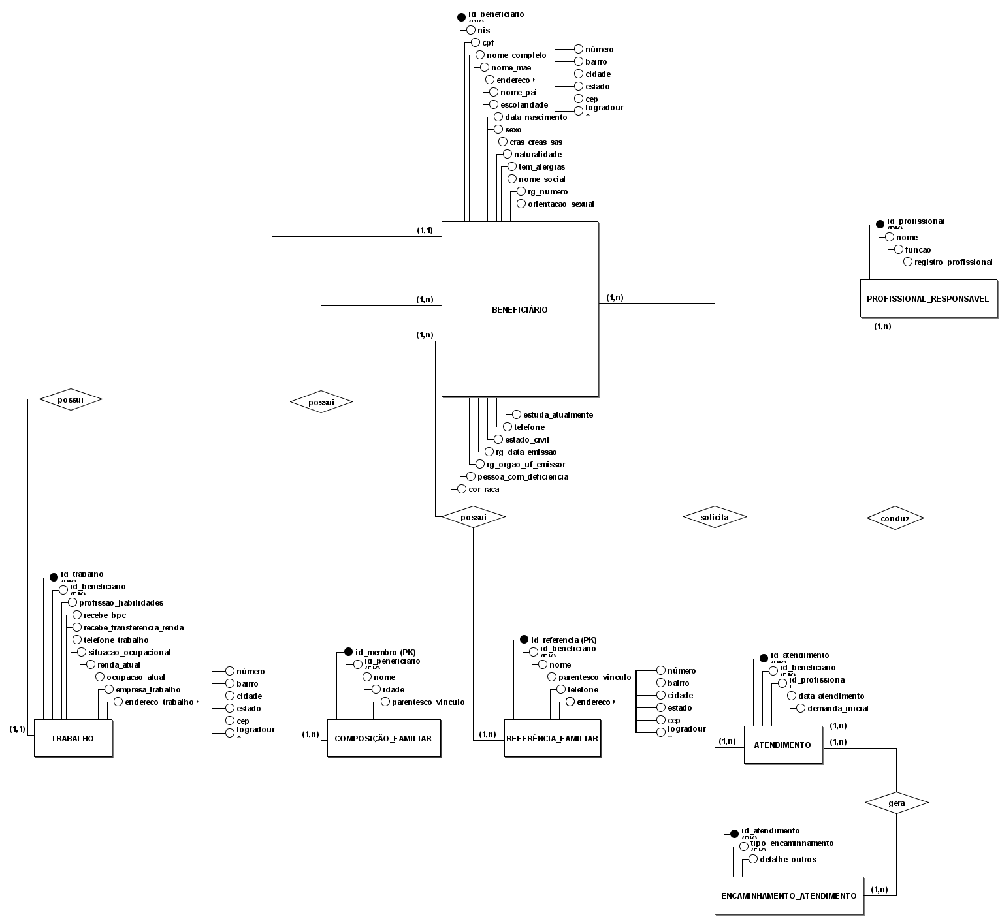

# 🏛️ Banco de Dados para a Organização Social Nossa Senhora de Fátima

**Modelagem conceitual (DER) para o cadastro e o atendimento de famílias em situação de vulnerabilidade social**

Projeto acadêmico em grupo sobre uma ONG real, localizada na **Mooca, São Paulo - SP**. A ONG atende famílias em vulnerabilidade social e hoje registra cada pessoa atendida em uma **Ficha de Cadastro/Atendimento em papel**. Este repositório organiza a modelagem de dados que substitui essa ficha por um sistema.

> 🔒 **Privacidade:** este repositório não contém dados pessoais reais de beneficiários, doadores, voluntários ou funcionários. Todos os exemplos são fictícios.

---

## 📦 O que tem aqui

| Item | Onde ver |
|---|---|
| 📘 Dicionário de dados conceitual (7 entidades) | [`docs/dicionario-de-dados.md`](docs/dicionario-de-dados.md) |
| 🗺️ Diagrama Entidade-Relacionamento (DER) | [`docs/DER.png`](docs/DER.png) |
| ✅ Testes automáticos da documentação | [`docs.test.js`](docs.test.js) |
| ⚙️ Esteira do GitHub Actions | [`.github/workflows/ci-cd.yml`](.github/workflows/ci-cd.yml) |



---

## 🧩 Entidades do modelo

| # | Entidade | Para que serve |
|:---:|---|---|
| 1 | **Beneficiário** | Pessoa atendida: identificação, documentos, educação e consentimento LGPD |
| 2 | **Trabalho** | Ocupação, renda e benefícios sociais do beneficiário |
| 3 | **Composição_Familiar** | Pessoas que moram com o beneficiário |
| 4 | **Referência_Familiar** | Pessoas de contato do beneficiário |
| 5 | **Atendimento** | Cada atendimento realizado e a demanda apresentada |
| 6 | **Encaminhamento_Atendimento** | Encaminhamentos marcados em cada atendimento (N:M) |
| 7 | **Profissional_Responsavel** | Técnico que conduz e assina o atendimento |

## ⚖️ Principais regras de negócio

- 🪪 **Nome social tem prioridade na comunicação.** O nome civil fica guardado para fins legais.
- 🤝 **A ONG não nega atendimento por falta de documento.** NIS, CPF, RG e telefone são opcionais.
- 🔐 **LGPD:** orientação sexual, cor/raça e dados de saúde só são preenchidos com consentimento registrado.
- 🧮 **A idade não é armazenada:** é calculada a partir da data de nascimento.

Todas as regras estão no [dicionário de dados](docs/dicionario-de-dados.md).

---

## 📋 Situação da Entrega 1

| Seção | Situação |
|---|---|
| Caracterização da organização | ⏳ A preencher pelo grupo |
| Processos de negócio e fluxogramas | ⏳ A preencher pelo grupo |
| Requisitos funcionais e não funcionais | ⏳ A preencher pelo grupo |
| Regras de negócio | ⏳ A preencher pelo grupo |
| **Dicionário de dados conceitual** | ✅ [Pronto](docs/dicionario-de-dados.md) |
| Modelagem conceitual | ⏳ A preencher pelo grupo |
| **DER** | ✅ [Anexado](docs/DER.png) (a ser atualizado conforme o anexo do dicionário) |
| Justificativa técnica | ⏳ A preencher pelo grupo |
| Uso de inteligência artificial | ⏳ A preencher pelo grupo |

---

## 🔁 Como o grupo trabalha neste repositório

1. Abrir uma **Issue** descrevendo a mudança.
2. Criar uma **branch** a partir da `main` (por exemplo, `feature/nome-social-obrigatorio`).
3. Fazer o **commit** da alteração.
4. Abrir um **Pull Request** com `Closes #número-da-issue` na descrição.
5. Esperar os **testes automáticos** ficarem verdes (job `test`).
6. Fazer o **merge**. A Issue fecha sozinha.

### ▶️ Rodar os testes localmente

Precisa do Node 20 ou mais novo:

```bash
npm test
```

Os testes conferem se os arquivos obrigatórios existem, se o dicionário tem as 7 entidades no formato padronizado, se os links do README funcionam e se não há dados pessoais reais (CPF, telefone ou e-mail) na documentação.
