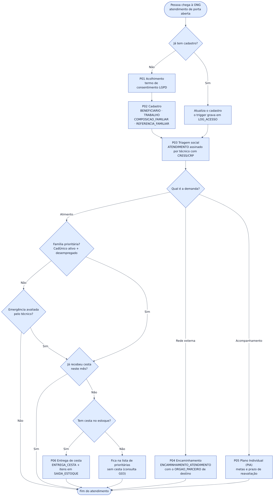
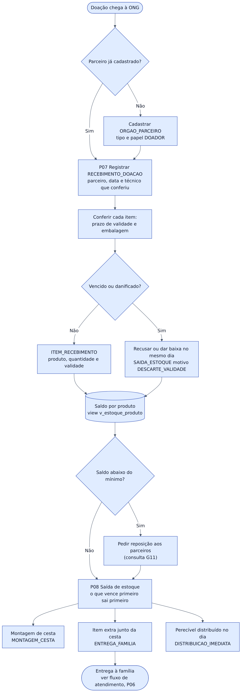
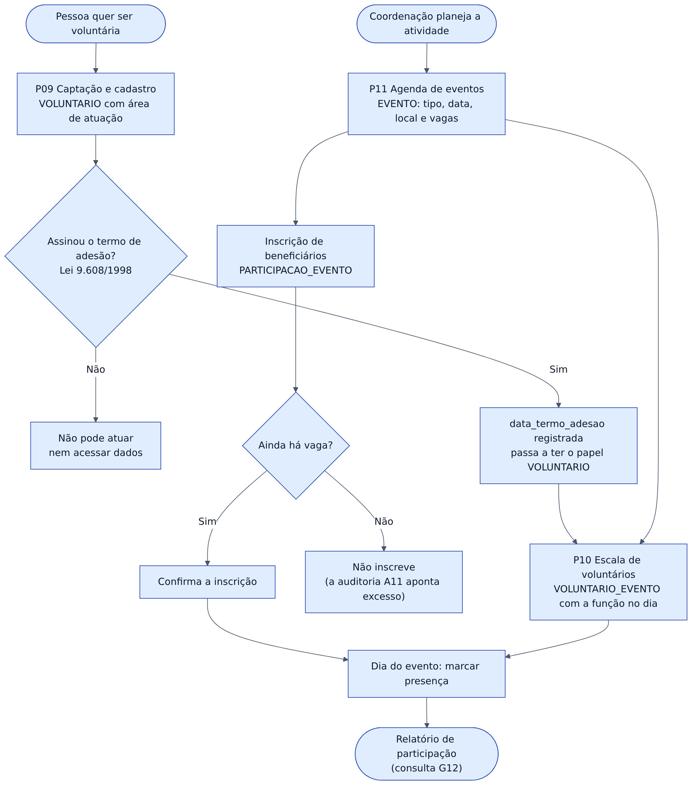
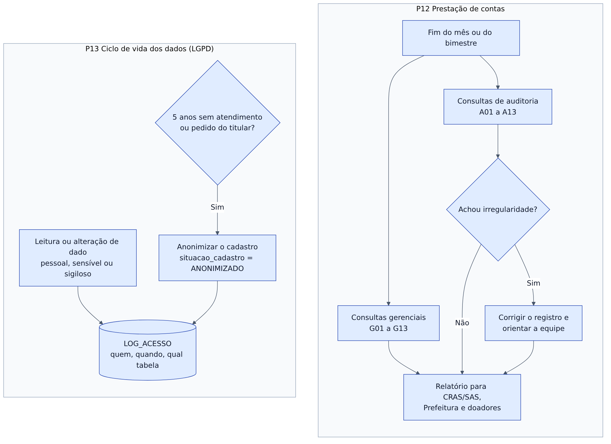
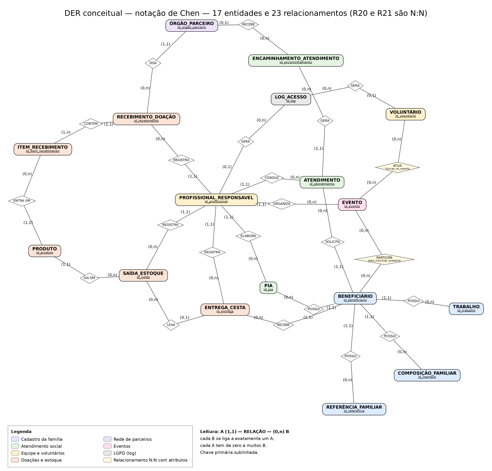
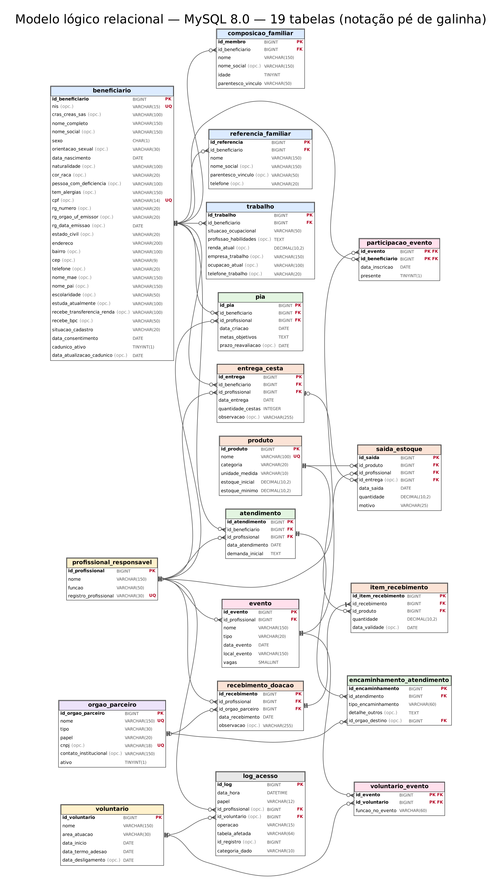

# Banco de Dados da Organização Social Nossa Senhora de Fátima

**Do modelo conceitual à implementação SQL: cadastro, atendimento, cestas básicas, doações, estoque, voluntários e eventos de uma ONG real da Mooca (São Paulo - SP).**

[](https://github.com/novaishenrique/ong-nsf/actions/workflows/ci-cd.yml)

| Integrante | RGM | GitHub |
| :--- | :--- | :--- |
| Gabriel Simões da Silva | 4732733 | [Gabriel-Simoes2006](https://github.com/Gabriel-Simoes2006) |
| Henrique Novais de Oliveira | 47046996 | [novaishenrique](https://github.com/novaishenrique) |
| Leandro Miranda da Silva | 47397349 | [mirandaleandro-creator](https://github.com/mirandaleandro-creator) |
| Mateus Alves dos Santos | 47435887 | [mateusalvesantos2025-dev](https://github.com/mateusalvesantos2025-dev) |
| Washington de Souza Silva | 49080156 | [washingtondesouzasilva1980-collab](https://github.com/washingtondesouzasilva1980-collab) |

**Vídeo de apresentação:** [defesa do modelo lógico e demonstração das consultas no MySQL Workbench](https://youtu.be/smOM2vWxMVs). O vídeo mostra a versão anterior à correção.

> 📌 Este repositório é a **versão revisada** do projeto do grupo ([repositório original](https://github.com/mateusalvesantos2025-dev/projeto-banco-de-dados-ong)), com as correções apontadas pelo professor na avaliação da Entrega 1 ([issue de correção](https://github.com/mateusalvesantos2025-dev/projeto-banco-de-dados-ong/issues/1)).
>
> 🔒 Nenhum dado pessoal real de beneficiários, voluntários ou da equipe aparece aqui. Toda a massa de dados é fictícia.

---

## Sumário

- [Correções do professor](#correções-do-professor)
- [0. Processos de negócio](#0-processos-de-negócio)
- [1. Diagnóstico da organização](#1-diagnóstico-da-organização)
- [2. Requisitos do sistema](#2-requisitos-do-sistema)
- [3. Regras de Negócio (RN)](#3-regras-de-negócio-rn)
- [4. Modelagem conceitual](#4-modelagem-conceitual)
- [5. DER, modelo lógico e normalização](#5-der-modelo-lógico-e-normalização)
- [6. Justificativa técnica](#6-justificativa-técnica)
- [7. Uso de inteligência artificial](#7-uso-de-inteligência-artificial)
- [8. BI, indicadores e rastreabilidade](#8-bi-indicadores-e-rastreabilidade)
- [9. Escopo e limitações](#9-escopo-e-limitações)
- [10. Conclusão](#10-conclusão)
- [11. Referências](#11-referências)
- [Estrutura do repositório e testes](#estrutura-do-repositório-e-testes)

---

## Correções do professor

A tabela abaixo mostra cada ponto da avaliação da Entrega 1, o que foi feito e onde conferir.

| Critério | Situação na E1 | O que foi feito | Onde |
| :--- | :--- | :--- | :--- |
| Processos de negócio | Não atendido: seção vazia, cobertura de 46% | 13 processos mapeados, cada um com responsável, tabelas, regras e consultas. Quatro fluxogramas. Entraram os que faltavam: captação de doações e de voluntários, estoque, escala de voluntários, agenda e prestação de contas | [Seção 0](#0-processos-de-negócio) |
| Requisitos e regras no modelo conceitual | Parcial: sem distribuição de cestas e sem PIA | `ENTREGA_CESTA` e `PIA` no DER, ligadas às regras RN04, RN05 e RN06. A entrega agora baixa o estoque | [Seção 4](#4-modelagem-conceitual) |
| Regras de negócio | Não atendido: cobertura de 45% | 18 regras. As que faltavam (elegibilidade e periodicidade das cestas, validade dos alimentos, consentimento e retenção LGPD) estão escritas e cada regra diz **onde o banco a garante** | [Seção 3](#3-regras-de-negócio-rn) |
| Dicionário de dados | Não atendido: sem fluxo de dados, convenções, notação, tipos físicos, índices, log, papéis e retenção; sem a entidade TRABALHO | Dicionário refeito para as 19 tabelas, com tipo físico, chave, obrigatoriedade, classe LGPD e regra de cada atributo, mais as seções de governança | [`dicionario-de-dados.md`](docs/dicionario-de-dados.md) |
| DER | Não atendido: `(1,n)` nos dois lados, FKs mal representadas, sem PIA e sem entrega de cestas | DER novo em notação de Chen com `(mín, máx)` coerentes com o dicionário. Modelo lógico em pé de galinha, gerado a partir do script SQL, com a FK sempre do lado N | [Seção 5](#5-der-modelo-lógico-e-normalização) |
| Justificativa técnica | Parcial: cardinalidades descritas, mas não defendidas | Cada uma das 23 relações tem a defesa do mínimo e do máximo e o efeito no banco | [Seção 6.2](#62-justificativa-das-cardinalidades) |
| Uso de IA | Parcial: sem justificativa da ferramenta final e sem a resposta recebida | Registro por etapa: ferramenta, pedido, resposta, o que foi aceito, o que foi rejeitado e por quê | [Seção 7](#7-uso-de-inteligência-artificial) |
| Entidades desejáveis | Sem ÓRGÃO PARCEIRO, VOLUNTÁRIO e EVENTO | As três foram criadas, mais `PRODUTO`, `ITEM_RECEBIMENTO`, `SAIDA_ESTOQUE` e `LOG_ACESSO` | [Seção 4](#4-modelagem-conceitual) |
| Caracterização | Justificativa do tema só implícita | Seção própria explicando a escolha da ONG | [Seção 1.3](#13-por-que-escolhemos-esta-ong) |
| Observação: privacidade | README expunha nome completo e telefone da assistente social | Dados retirados. A equipe técnica é citada só pela função | [Seção 1](#1-diagnóstico-da-organização) e [levantamento](docs/levantamento/levantamento.md) |
| Observação: conflito de interesse | Acesso à ONG por meio de um integrante | Conflito declarado, com as medidas tomadas para reduzir o viés | [Seção 1.2](#12-acesso-à-ong-e-conflito-de-interesse) |

**Outros erros encontrados na revisão do repositório do grupo:**

| Problema | Correção |
| :--- | :--- |
| O `massa-dados.sql` usava uma versão antiga das tabelas e não rodava junto com o `script.sql` | Os scripts foram separados em estrutura, massa e consultas ([`docs/sql/`](docs/sql)) e rodam em sequência num MySQL 8.0 limpo a cada push |
| Doação guardava os itens em texto livre (`descricao_itens`, `quantidade_total`) | Itens viraram linhas de `ITEM_RECEBIMENTO`, com produto, quantidade e validade |
| Entrega guardava itens extras em texto livre (`itens_adicionais`) | Itens extras viraram linhas de `SAIDA_ESTOQUE` ligadas à entrega |
| Doador era texto repetido em cada doação (`parceiro_doador`) | Doador virou a entidade `ORGAO_PARCEIRO` |
| Encaminhamento dizia o tipo, mas não o órgão de destino | FK `id_orgao_destino` para `ORGAO_PARCEIRO` |
| Comentário no SQL dizia que "o MySQL não tem variáveis" | Corrigido. O script usa variáveis de sessão no trigger de log |
| Não havia documentação da massa de dados | [`docs/massa-de-dados.md`](docs/massa-de-dados.md) |

---

## 0. Processos de negócio

A ONG atende de **porta aberta**: a pessoa chega, é acolhida, passa pela triagem com a assistente social e, a partir dela, recebe cesta, é encaminhada para a rede externa ou entra em acompanhamento. Em paralelo, a ONG recebe doações, controla o estoque, organiza eventos com voluntários e presta contas à Prefeitura, ao CRAS/SAS e aos doadores.

### 0.1 Tabela dos processos

| # | Processo | Quem faz | Tabelas | Regras | Consultas | Na E1 | Agora |
| :---: | :--- | :--- | :--- | :---: | :---: | :---: | :---: |
| P01 | Acolhimento e termo de consentimento LGPD | Técnico | `beneficiario` | RN07 | A06 | Coberto | ✅ |
| P02 | Cadastro do titular, da família e dos contatos | Técnico | `beneficiario`, `trabalho`, `composicao_familiar`, `referencia_familiar` | RN01, RN10 | G09, A07 | Coberto | ✅ |
| P03 | Triagem socioassistencial | Técnico | `atendimento` | RN03, RN11 | G05, A08 | Coberto | ✅ |
| P04 | Encaminhamento para a rede externa | Técnico | `encaminhamento_atendimento`, `orgao_parceiro` | RN18 | G06 | Sem órgão de destino | ✅ |
| P05 | Acompanhamento continuado (PIA) | Técnico | `pia` | RN04 | G07, G08 | Coberto | ✅ |
| P06 | Concessão e entrega de cestas | Técnico | `entrega_cesta`, `saida_estoque` | RN05, RN06 | G02 a G04, A01 a A03 | Coberto | ✅ |
| P07 | Captação e recebimento de doações | Técnico ou coordenação | `orgao_parceiro`, `recebimento_doacao`, `item_recebimento` | RN09, RN12 | G10, A10 | Sem itens e sem parceiro | ✅ |
| P08 | Controle de estoque (saldo, mínimo, validade, descarte) | Técnico ou voluntário | `produto`, `saida_estoque`, view `v_estoque_produto` | RN13, RN14 | G11, A09 | Ausente | ✅ |
| P09 | Captação e cadastro de voluntários | Coordenação | `voluntario` | RN15 | A12 | Ausente | ✅ |
| P10 | Escala de voluntários nos eventos | Coordenação | `voluntario_evento` | RN15 | G12, A12 | Ausente | ✅ |
| P11 | Agenda de eventos e das reavaliações do PIA | Coordenação e técnico | `evento`, `participacao_evento`, `pia` | RN04, RN16 | G07, G12, A11 | Parcial | ✅ |
| P12 | Prestação de contas (CRAS/SAS, Prefeitura, doadores) | Coordenação | Leitura de todas | RN08 | G01 a G13, A01 a A13 | Coberto | ✅ |
| P13 | Controle de acesso e ciclo de vida dos dados | Sistema e técnico | `log_acesso`, `beneficiario` | RN02, RN07, RN17 | G13, A05, A13 | Ausente | ✅ |

As consultas G (gerenciais) e A (auditoria) estão em [`03_consultas.sql`](docs/sql/03_consultas.sql). Quem faz cada coisa segue a matriz de papéis do [dicionário, seção 0.4](docs/dicionario-de-dados.md#04-papéis-e-permissões).

### 0.2 Fluxogramas

Os fluxogramas foram escritos em Mermaid ([fontes em `docs/fluxogramas/`](docs/fluxogramas)) e exportados como imagem.

**Fluxo 1. Atendimento socioassistencial (P01 a P06)**



**Fluxo 2. Doações e estoque (P07 e P08)**



**Fluxo 3. Voluntários e eventos (P09 a P11)**



**Fluxo 4. Prestação de contas e LGPD (P12 e P13)**



---

## 1. Diagnóstico da organização

<p align="center"><br><sub>Fachada da ONG e da Loja Social, na visita do grupo em 12/09/2026</sub></p>

### 1.1 Identificação

| Item | Informação |
| :--- | :--- |
| Organização | Organização Social Nossa Senhora de Fátima |
| CNPJ | 32.667.614/0001-18 |
| Site | [ongnossasenhoradefatima.com.br](http://www.ongnossasenhoradefatima.com.br) |
| Local | Mooca, São Paulo - SP |
| Porte | Pequeno: cerca de 250 famílias cadastradas, o presidente e cerca de 5 voluntários fixos |
| Equipe técnica | Assistente social responsável pelas triagens (nome omitido por privacidade) |
| Serviços | Acolhimento, triagem, cestas básicas, encaminhamentos para a rede pública (saúde e saúde mental, habitação, jurídico e outros), acompanhamento pelo PIA, passeios e atividades nos fins de semana |
| Como os dados eram gerados | Ficha de cadastro e atendimento em papel, guardada em armário |

### 1.2 Acesso à ONG e conflito de interesse

O grupo chegou à ONG por meio de **Washington de Souza Silva**, integrante do grupo e presidente da instituição. Isso é um **conflito de interesse**: quem descreve a operação também a dirige. Para reduzir o viés:

- a entrevista técnica também foi feita com a assistente social, que não faz parte do grupo;
- o modelo foi conferido contra a ficha em papel, e não só contra o relato do presidente;
- nenhum dado real foi usado: toda a massa é fictícia.

O relatório da visita, com as fotos, está em [`docs/levantamento/levantamento.md`](docs/levantamento/levantamento.md).

### 1.3 Por que escolhemos esta ONG

- É uma **organização real e acessível**: o grupo pôde visitar, entrevistar a equipe e ver a ficha em papel.
- O problema é **de dados**: tudo é registrado à mão, o histórico se perde e não há como provar para quem foi cada cesta.
- O domínio tem **regras de verdade para modelar**: elegibilidade de cestas, lote da Prefeitura, validade de alimentos, sigilo profissional e LGPD.
- O resultado tem **uso prático**: o modelo pode virar o sistema da ONG.

### 1.4 Descrição do negócio

A ONG acolhe pessoas em vulnerabilidade social na região da Mooca. A assistente social faz uma entrevista e preenche a ficha de triagem (dados pessoais, trabalho e renda, família, contatos e demanda). A partir dela, a ONG entrega cesta básica, encaminha para a rede pública (saúde e saúde mental, habitação, assistência jurídica e outros serviços) ou abre um Plano Individual de Atendimento (PIA).

As cestas vêm de um **lote de 150 cestas a cada 2 meses** da Prefeitura e de doações esporádicas (Banco de Alimentos, Projeto Cidade Invisível, paróquia e particulares). Nos fins de semana, a ONG organiza passeios, oficinas e festas, com a ajuda de voluntários.

### 1.5 Problema a resolver

| Problema hoje | Consequência | O que o banco resolve |
| :--- | :--- | :--- |
| Fichas em papel | Desgaste, perda e busca lenta do histórico | Cadastro único com histórico completo (G01) |
| Cestas sem registro | Risco de duplicidade e de família prioritária sem cesta | Entrega registrada, com elegibilidade e periodicidade auditadas (G03, A02, A03) |
| Doações sem controle | Não há saldo nem validade | Estoque item a item, com saldo e alerta de reposição (G11) |
| Dados sensíveis em armário | Não se sabe quem acessou | Papéis, log de acesso e anonimização (G13, A13, RN07) |
| Relatórios feitos à mão | Prestação de contas demorada | Consultas prontas para CRAS/SAS, Prefeitura e doadores (G02, G05, G10) |

---

## 2. Requisitos do sistema

### 2.1 Requisitos funcionais (RF)

| # | O sistema deve... |
| :---: | :--- |
| RF01 | Cadastrar o beneficiário, a família e os contatos de emergência, sem permitir CPF ou NIS repetido |
| RF02 | Registrar cada triagem e atendimento, com o profissional responsável |
| RF03 | Registrar encaminhamentos com o tipo e o órgão de destino |
| RF04 | Registrar o PIA, com metas e prazo de reavaliação |
| RF05 | Registrar a entrega de cestas e dos itens que vão junto, respeitando elegibilidade e periodicidade |
| RF06 | Registrar cada doação com o parceiro, os produtos, as quantidades e a validade |
| RF07 | Mostrar o saldo de cada produto, avisar quando estiver abaixo do mínimo e registrar descartes |
| RF08 | Cadastrar voluntários, com data de início, termo de adesão e desligamento |
| RF09 | Agendar eventos, inscrever beneficiários, controlar vagas e presença e montar a escala de voluntários |
| RF10 | Consultar o histórico completo de uma família |
| RF11 | Emitir os relatórios de prestação de contas e de auditoria |
| RF12 | Registrar quem acessou ou alterou dados pessoais, sensíveis e sigilosos, e anonimizar cadastros no fim do prazo |

### 2.2 Requisitos não funcionais (RNF)

| # | Requisito |
| :---: | :--- |
| RNF01 | **Segurança e LGPD:** acesso por papel (`TECNICO`, `ADMIN`, `VOLUNTARIO`), conforme a matriz do dicionário |
| RNF02 | **Desempenho:** busca por CPF, NIS ou nome em até 2 segundos, com índices nessas colunas |
| RNF03 | **Integridade:** chaves estrangeiras, `CHECK` e `ON DELETE RESTRICT`; registro com histórico não é apagado |
| RNF04 | **Disponibilidade:** funcionar no horário de atendimento, com backup diário |
| RNF05 | **Usabilidade:** telas simples para a recepção e para a equipe técnica |
| RNF06 | **Auditoria:** data, hora, usuário e operação em `log_acesso` |
| RNF07 | **Padronização:** MySQL 8.0, `utf8mb4`, nomes em `snake_case`, scripts versionados e testados a cada push |

---

## 3. Regras de Negócio (RN)

Cada regra diz o que vale, por que existe e **onde o banco a garante**. Quando o MySQL não consegue garantir sozinho (por exemplo, contar linhas antes de inserir), a aplicação confere e uma consulta de auditoria aponta o que escapou.

| # | Regra | Por quê | Onde é garantida |
| :---: | :--- | :--- | :--- |
| RN01 | Cada pessoa tem um só cadastro. CPF e NIS são opcionais, mas não podem se repetir | Evitar cadastro duplicado sem negar atendimento a quem não tem documento | `uq_beneficiario_cpf`, `uq_beneficiario_nis` e `CHECK` de formato |
| RN02 | Dados sensíveis e sigilosos só são vistos pela equipe técnica | Sigilo profissional e LGPD (art. 11) | Matriz de papéis ([dicionário 0.4](docs/dicionario-de-dados.md#04-papéis-e-permissões)), `log_acesso` e auditoria **A13** |
| RN03 | Sem triagem, não há cesta, encaminhamento nem PIA | O auxílio vai para quem foi avaliado | Encaminhamento tem FK obrigatória para `atendimento`; cesta sem triagem anterior aparece na **A01** |
| RN04 | Todo PIA tem metas e prazo de reavaliação, que não pode ser anterior à criação do plano | Acompanhar a evolução da família | `ck_pia_prazo`; vencidos nas consultas **G07** e **G08** |
| RN05 | As cestas vêm do lote de 150 da Prefeitura a cada 2 meses e de doações esporádicas | Saber a origem de cada cesta | `recebimento_doacao` ligado a `orgao_parceiro` do tipo `PREFEITURA`; taxa de distribuição na **G02** |
| RN06 | **Elegibilidade e periodicidade:** tem prioridade a família com CadÚnico ativo e sem emprego; cada família recebe no máximo uma entrega por mês; exceção só por emergência avaliada pelo técnico, anotada em `observacao` | Recursos limitados vão para quem mais precisa, sem duplicar | Consultas **G03** e **G04**; auditorias **A02** (fora do critério), **A03** (duas no mês) e **A04** (CadÚnico desatualizado) |
| RN07 | **Consentimento e retenção:** o consentimento é registrado antes do primeiro atendimento; após 5 anos sem atendimento, ou a pedido do titular, o cadastro é anonimizado | LGPD (art. 7º, 11, 15 e 16) | `data_consentimento NOT NULL`, `situacao_cadastro`; anonimização na seção 6.3 do script; auditorias **A05** e **A06** |
| RN08 | O sistema gera os relatórios para CRAS/SAS, Prefeitura e doadores | Prestação de contas | Consultas **G01** a **G13** |
| RN09 | **Validade dos alimentos:** todo item é conferido na chegada; item vencido é recusado ou descartado no mesmo dia | Segurança alimentar | `item_recebimento.data_validade`; auditoria **A10** |
| RN10 | No máximo 5 moradores e 3 contatos por família | Segue o formato da ficha em papel | Aplicação; auditoria **A07** |
| RN11 | Todo registro técnico tem um profissional com CRESS ou CRP | Responsabilidade técnica | FK obrigatória para `profissional_responsavel` e `registro_profissional NOT NULL`; auditoria **A08** |
| RN12 | Toda doação tem parceiro de origem e pelo menos um item | Rastrear de onde veio cada produto | `recebimento_doacao.id_orgao_parceiro NOT NULL`; itens em `item_recebimento` |
| RN13 | Só sai do estoque o que entrou; item que vai para uma família aponta a entrega | Saldo confiável | View `v_estoque_produto`, `ck_saida_entrega`; auditoria **A09** |
| RN14 | Sai primeiro o que vence primeiro; descarte é registrado com motivo | Evitar perda e provar o descarte | `saida_estoque.motivo` (`DESCARTE_VALIDADE`); próxima validade na **G11** |
| RN15 | Voluntário só atua depois de assinar o termo de adesão e até o desligamento | Lei 9.608/1998 | `data_termo_adesao NOT NULL`, `ck_voluntario_datas`; auditoria **A12** |
| RN16 | Um evento não pode ter mais inscritos que vagas | Segurança e organização dos passeios | `ck_evento_vagas`; aplicação; auditoria **A11** |
| RN17 | Todo acesso a dado pessoal, sensível ou sigiloso é registrado, com um único autor | Rastreabilidade exigida pela LGPD | `log_acesso`, trigger `trg_beneficiario_log_alteracao`, `ck_log_um_ator`, `ck_log_papel_ator`; consultas **G13** e **A13** |
| RN18 | Encaminhamento aponta o órgão de destino | Medir a rede externa e cobrar retorno | `fk_encaminhamento_orgao`; consulta **G06** |

---

## 4. Modelagem conceitual

São **17 entidades** e **23 relacionamentos**. Duas relações N:N (`PARTICIPA` e `ATUA`) viram tabelas associativas no modelo lógico, o que dá **19 tabelas**.

| Área | Entidades | Novidade |
| :--- | :--- | :--- |
| 🔵 Família | `BENEFICIARIO`, `TRABALHO`, `COMPOSICAO_FAMILIAR`, `REFERENCIA_FAMILIAR` | |
| 🟢 Atendimento | `ATENDIMENTO`, `ENCAMINHAMENTO_ATENDIMENTO`, `PIA` | Encaminhamento ligado ao órgão de destino |
| 🟠 Doações e estoque | `RECEBIMENTO_DOACAO`, `ITEM_RECEBIMENTO`, `PRODUTO`, `ENTREGA_CESTA`, `SAIDA_ESTOQUE` | `ITEM_RECEBIMENTO`, `PRODUTO` e `SAIDA_ESTOQUE` são novas |
| 🟣 Parceiros | `ORGAO_PARCEIRO` | Nova: doadores e rede de encaminhamento |
| 🟡 Pessoas da ONG | `PROFISSIONAL_RESPONSAVEL`, `VOLUNTARIO` | `VOLUNTARIO` é nova |
| 🩷 Eventos | `EVENTO`, mais as associativas `PARTICIPACAO_EVENTO` e `VOLUNTARIO_EVENTO` | Novas |
| ⚪ Auditoria | `LOG_ACESSO` | Nova |

As 23 relações, com cardinalidade e FK, estão no [dicionário, seção 2](docs/dicionario-de-dados.md#2-relacionamentos-e-cardinalidades). A defesa de cada uma está na [seção 6.2](#62-justificativa-das-cardinalidades).

---

## 5. DER, modelo lógico e normalização

### 5.1 DER conceitual (notação de Chen)

Entidade em retângulo, relacionamento em losango e cardinalidade `(mín, máx)` em cada ponta. Na E1, várias relações tinham `(1,n)` dos dois lados, o que diria, por exemplo, que um registro de trabalho pertence a vários beneficiários. Agora cada ponta tem o mínimo e o máximo que a regra de negócio permite.



### 5.2 Modelo lógico (notação pé de galinha)

Gerado a partir do próprio [`01_estrutura.sql`](docs/sql/01_estrutura.sql), para o desenho nunca ficar diferente do banco. Cada tabela mostra colunas, tipo físico, `PK`, `FK`, `UQ` e as colunas opcionais. A FK fica sempre na tabela do lado N. Traço duplo é "exatamente um"; círculo é "zero"; pé de galinha é "muitos". As cores seguem as áreas da seção 4.



### 5.3 Normalização

| Forma normal | O que exige | Exemplo neste modelo |
| :--- | :--- | :--- |
| **1FN** | Valores atômicos, sem listas dentro de uma coluna | Moradores e contatos da ficha viraram `composicao_familiar` e `referencia_familiar`. A lista de itens da doação (`descricao_itens`) virou `item_recebimento`. Os itens extras da entrega (`itens_adicionais`) viraram `saida_estoque` |
| **2FN** | Em chave composta, todo atributo depende da chave inteira | Em `participacao_evento` (PK `id_evento` + `id_beneficiario`), `data_inscricao` e `presente` dependem do par. O nome e a data do evento ficam em `evento`, porque dependem só de `id_evento` |
| **3FN** | Nenhum atributo depende de outro que não é chave | O nome do doador repetido em cada doação virou `orgao_parceiro`. O saldo do estoque não é guardado: é calculado na view `v_estoque_produto`. A idade do titular é calculada pela data de nascimento |

---

## 6. Justificativa técnica

### 6.1 Escolha das entidades

| Entidade | Por que existe |
| :--- | :--- |
| `BENEFICIARIO` | Centro do modelo: uma linha por titular atendido |
| `TRABALHO` | Separada porque muda com o tempo e é dado sigiloso (renda). Na E1 faltava no dicionário |
| `COMPOSICAO_FAMILIAR` e `REFERENCIA_FAMILIAR` | Listas da ficha em papel (1FN) |
| `ATENDIMENTO` | Cada triagem ou retorno, assinado por um técnico (RN11) |
| `ENCAMINHAMENTO_ATENDIMENTO` | Cada encaminhamento gerado no atendimento, com o órgão de destino (RN18) |
| `PIA` | Exigido pela RN04; faltava no DER da E1 |
| `ENTREGA_CESTA` | Principal auxílio da ONG; faltava no DER da E1 |
| `ORGAO_PARCEIRO` | Um cadastro só para quem doa e para quem recebe encaminhamentos. O campo `papel` diz `DOADOR`, `REDE_ENCAMINHAMENTO` ou `AMBOS` |
| `PRODUTO`, `RECEBIMENTO_DOACAO`, `ITEM_RECEBIMENTO`, `SAIDA_ESTOQUE` | Entrada e saída item a item. Sem elas não existe saldo nem controle de validade (RN09, RN13, RN14) |
| `VOLUNTARIO` | Separado do profissional: não tem registro de conselho e tem termo de adesão (RN15) |
| `EVENTO`, `PARTICIPACAO_EVENTO`, `VOLUNTARIO_EVENTO` | Agenda, vagas, presença e escala (RN16) |
| `LOG_ACESSO` | Prova de quem acessou dado pessoal, sensível ou sigiloso (RN17) |

### 6.2 Justificativa das cardinalidades

Para cada relação, duas perguntas: **o mínimo** ("um lado pode existir sem o outro?") e **o máximo** ("um lado pode ter mais de um do outro?"). A resposta vira, no banco, FK obrigatória (`NOT NULL`), FK opcional ou tabela associativa.

| # | Relação | Cardinalidade | Por que esse mínimo e esse máximo | No banco |
| :---: | :--- | :---: | :--- | :--- |
| R01 | BENEFICIÁRIO possui TRABALHO | (1,1) : (0,n) | Trabalho não existe sem titular. O titular pode estar sem registro (quem nunca trabalhou) ou ter vários ao longo do tempo | FK `NOT NULL` em `trabalho` |
| R02 | BENEFICIÁRIO possui COMPOSIÇÃO_FAMILIAR | (1,1) : (0,n) | Morador sempre é da família de um titular. Quem mora sozinho tem zero | FK `NOT NULL`; limite de 5 pela RN10 |
| R03 | BENEFICIÁRIO possui REFERÊNCIA_FAMILIAR | (1,1) : (0,n) | Contato é sempre de um titular. Ter contato não é obrigatório | FK `NOT NULL`; limite de 3 pela RN10 |
| R04 | BENEFICIÁRIO solicita ATENDIMENTO | (1,1) : (0,n) | Atendimento é sempre de alguém. O cadastro pode existir antes do primeiro atendimento (acolhimento) | FK `NOT NULL` |
| R05 | PROFISSIONAL conduz ATENDIMENTO | (1,1) : (0,n) | Todo atendimento é assinado (RN11). Profissional recém-cadastrado ainda não tem atendimentos | FK `NOT NULL` |
| R06 | ATENDIMENTO gera ENCAMINHAMENTO | (1,1) : (0,n) | Encaminhamento só nasce de uma triagem (RN03). A maioria dos atendimentos não gera encaminhamento | FK `NOT NULL` |
| R07 | ÓRGÃO_PARCEIRO recebe ENCAMINHAMENTO | (0,1) : (0,n) | O destino pode ser um órgão ainda não cadastrado (tipo "Outros"), por isso o mínimo é 0. Um encaminhamento vai para um órgão só | FK opcional |
| R08 | BENEFICIÁRIO possui PIA | (1,1) : (0,n) | Plano é sempre de uma família. Só quem precisa de acompanhamento tem PIA; um novo plano substitui o anterior | FK `NOT NULL` |
| R09 | PROFISSIONAL elabora PIA | (1,1) : (0,n) | Todo plano tem um técnico responsável (RN11) | FK `NOT NULL` |
| R10 | BENEFICIÁRIO recebe ENTREGA_CESTA | (1,1) : (0,n) | Entrega é sempre para uma família. Nem toda família recebe cesta | FK `NOT NULL` |
| R11 | PROFISSIONAL registra ENTREGA_CESTA | (1,1) : (0,n) | Toda entrega tem quem autorizou | FK `NOT NULL` |
| R12 | ÓRGÃO_PARCEIRO doa RECEBIMENTO_DOAÇÃO | (1,1) : (0,n) | Não existe doação sem origem (RN12). Um órgão da rede de encaminhamento nunca doa | FK `NOT NULL` |
| R13 | PROFISSIONAL registra RECEBIMENTO_DOAÇÃO | (1,1) : (0,n) | Toda doação tem quem conferiu a validade (RN09) | FK `NOT NULL` |
| R14 | RECEBIMENTO_DOAÇÃO contém ITEM_RECEBIMENTO | (1,1) : (1,n) | Item não existe fora de uma doação. Doação sem item não faz sentido, por isso o mínimo do lado N é 1 | FK `NOT NULL`; mínimo de 1 item conferido na aplicação |
| R15 | PRODUTO entra em ITEM_RECEBIMENTO | (1,1) : (0,n) | Cada item é de um produto do catálogo. Produto novo ainda não recebeu doação | FK `NOT NULL` |
| R16 | PRODUTO sai em SAÍDA_ESTOQUE | (1,1) : (0,n) | Cada saída é de um produto | FK `NOT NULL` |
| R17 | ENTREGA_CESTA leva SAÍDA_ESTOQUE | (0,1) : (0,n) | Montagem de cesta e descarte saem sem entrega (mínimo 0). Item que vai para uma família aponta uma entrega só | FK opcional; `ck_saida_entrega` exige a FK quando o motivo é `ENTREGA_FAMILIA` |
| R18 | PROFISSIONAL registra SAÍDA_ESTOQUE | (1,1) : (0,n) | Toda saída tem responsável | FK `NOT NULL` |
| R19 | PROFISSIONAL organiza EVENTO | (1,1) : (0,n) | Todo evento tem responsável | FK `NOT NULL` |
| R20 | BENEFICIÁRIO participa EVENTO | (0,n) : (0,n) | Um evento tem vários participantes e uma pessoa vai a vários eventos. Nenhum lado é obrigatório | Associativa `participacao_evento`, PK composta |
| R21 | VOLUNTÁRIO atua EVENTO | (0,n) : (0,n) | Um evento tem vários voluntários e um voluntário trabalha em vários eventos | Associativa `voluntario_evento`, PK composta |
| R22 | PROFISSIONAL gera LOG_ACESSO | (0,1) : (0,n) | Cada linha do log tem um autor: profissional **ou** voluntário. Por isso cada FK, sozinha, é opcional | FK opcional; `ck_log_um_ator` exige exatamente uma das duas |
| R23 | VOLUNTÁRIO gera LOG_ACESSO | (0,1) : (0,n) | Mesmo raciocínio da R22 | FK opcional; `ck_log_um_ator` |

### 6.3 Decisões e alternativas rejeitadas

| Alternativa | Por que foi rejeitada |
| :--- | :--- |
| CPF ou NIS como chave primária | Quem chega sem documento precisa ser atendido. A PK é sintética (`id_*`) e CPF/NIS são `UNIQUE` opcionais |
| Uma tabela `PESSOA` para beneficiário, profissional e voluntário | Atributos, regras e classes LGPD muito diferentes. Juntar criaria muitas colunas vazias |
| Saldo do estoque como coluna em `produto` | Ficaria diferente das entradas e saídas no primeiro erro. A view calcula o saldo sempre a partir do histórico |
| Itens da doação e da entrega em texto livre | Não permite somar, controlar validade nem auditar (violava a 1FN) |
| `ON DELETE CASCADE` | Apagaria histórico usado na prestação de contas. Com `RESTRICT`, o caminho para dado pessoal é a anonimização (RN07) |
| Log só na aplicação | Uma alteração feita direto no banco não deixaria rastro. O trigger garante o log das alterações no cadastro do beneficiário |

### 6.4 Chaves e índices

- **PK:** `BIGINT UNSIGNED AUTO_INCREMENT`, com nome `id_<tabela>`. As duas associativas usam PK composta pelas duas FKs.
- **FK:** mesmo nome e tipo da PK referenciada, constraint `fk_<tabela>_<referência>`, sempre `RESTRICT`.
- **Índices:** CPF, NIS e nome (busca na recepção, RNF02), todas as FKs (JOIN) e as datas usadas nos relatórios. A lista completa está no [dicionário, seção 0.7](docs/dicionario-de-dados.md#07-índices).

### 6.5 Scripts SQL

| Arquivo | Conteúdo |
| :--- | :--- |
| [`01_estrutura.sql`](docs/sql/01_estrutura.sql) | Banco, 19 tabelas com `CHECK`, `UNIQUE` e FKs, índices, view do estoque e trigger do log |
| [`02_massa_dados.sql`](docs/sql/02_massa_dados.sql) | Massa fictícia: 250 famílias, 727 atendimentos, 237 entregas, 19 doações, 8 eventos e mais. Explicada em [`massa-de-dados.md`](docs/massa-de-dados.md) |
| [`03_consultas.sql`](docs/sql/03_consultas.sql) | SELECT com JOIN, UPDATE e DELETE, 13 consultas gerenciais e 13 de auditoria |

O GitHub Actions roda os três arquivos, nesta ordem, num MySQL 8.0 limpo a cada push. Se uma tabela, constraint ou consulta quebrar, o job `banco` fica vermelho.

---

## 7. Uso de inteligência artificial

### 7.1 Entrega 1 (feita pelo grupo)

| Item | Registro |
| :--- | :--- |
| Ferramentas | Google Gemini (gratuito), ChatGPT (gratuito) e Claude (plano Pro) |
| Para quê | Organizar o Markdown e o dicionário; revisar regras, cardinalidades e normalização; ajudar a escrever o script SQL e a massa de dados |
| Exemplo de pedido | "Com base nos apontamentos do professor, ajude a revisar e corrigir as cardinalidades dos relacionamentos e a isolar a entidade Trabalho de forma normalizada." |
| Resposta recebida | Separar `TRABALHO`; trocar `(1,n)` ambíguo por `(1,1) : (0,n)`; incluir controle de acesso pela LGPD; modelos de tabela para o dicionário; script e massa em SQL |
| O que o grupo corrigiu | Nomes em `snake_case`, cardinalidades que vieram ambíguas, termos genéricos trocados pelos da assistência social brasileira (CRAS, CadÚnico, PIA) e erros de sintaxe nos `INSERT` |
| O que o grupo rejeitou | Na época, o controle de estoque (considerado fora do escopo). Na revisão abaixo, essa decisão foi revista porque o professor apontou o estoque como processo esperado |

### 7.2 Revisão após a correção (este repositório)

| Item | Registro |
| :--- | :--- |
| Ferramenta | Claude (Anthropic), pelo app do Claude |
| Pedido | Arrumar o repositório para ficar completo como o do grupo, com imagens, e aplicar as correções da issue do professor |
| Resposta recebida | Proposta de 6 entidades novas (órgão parceiro, produto, item de recebimento, saída de estoque, voluntário, evento) mais 2 associativas e o log; reescrita do dicionário com governança; DER e modelo lógico gerados a partir do script; fluxogramas; 18 regras com o local onde o banco garante cada uma; casos irregulares na massa para cada auditoria; testes e CI com MySQL 8.0 |
| O que foi conferido | Os três scripts rodam do zero, em sequência e sem erro, num MySQL 8.0 limpo no GitHub Actions (job `banco`); a contagem de cada tabela bate com a esperada; o trigger grava o log; cada auditoria encontra o caso irregular plantado. Os testes conferem links, imagens, as 19 entidades do dicionário e a ausência de dados pessoais. O resumo da última execução fica na branch `ci-resultado` |
| O que foi ajustado | Três `CHECK` reescritos em forma `AND`/`OR`, mais portável; o modelo lógico passou a ser gerado do script para não divergir do desenho |
| Por que esta ferramenta na versão final | Ela consegue executar o SQL e gerar os diagramas a partir do mesmo script, o que mantém dicionário, desenhos e banco iguais. As decisões de escopo continuam sendo do grupo e estão na seção 9 |

---

## 8. BI, indicadores e rastreabilidade

### 8.1 Indicadores (KPIs)

As metas são uma **sugestão** para validar com a ONG. Os valores são os da massa de dados fictícia.

| KPI | Fórmula | Período | Meta sugerida | Consulta | Valor na massa |
| :--- | :--- | :---: | :---: | :---: | :--- |
| KPI1 Distribuição do lote | cestas entregues ÷ cestas recebidas × 100 | Bimestral | 95% a 100% | G02 | 100,7% (jul-ago) e 99,3% (set-out) |
| KPI2 Focalização | cestas para famílias prioritárias ÷ total de cestas × 100 | Bimestral | ≥ 85% | G04 | 82,1% e 79,2% |
| KPI3 Prioritárias sem cesta | famílias prioritárias sem entrega no bimestre | Bimestral | 0 | G03 | 23 famílias em set-out |
| KPI4 Volume de atendimento | atendimentos, pessoas e novos cadastros | Mensal | Acompanhar | G05 | 78 a 94 atendimentos por mês |
| KPI5 Rede externa | encaminhamentos por tipo ÷ total × 100 | Período | Acompanhar | G06 | CRAS e habitação lideram (16,2% cada) |
| KPI6 PIAs vencidos | PIAs com reavaliação vencida ÷ PIAs vigentes × 100 | Na data | ≤ 10% | G08 | 33,3% |
| KPI7 Produtos para repor | produtos com saldo abaixo do mínimo | Semanal | 0 | G11 | 1 (cesta básica, à espera do lote de novembro) |
| KPI8 Presença em eventos | presentes ÷ inscritos × 100 | Por evento | ≥ 80% | G12 | 82% a 97% |
| KPI9 Acessos fora do papel | acessos a dado sensível ou sigiloso por quem não é técnico | Mensal | 0 | A13 | 3 |

Na massa, KPI2, KPI3 e KPI6 ficam abaixo da meta de propósito: o painel serve para mostrar onde agir.

### 8.2 Painéis de BI

| Painel | O que mostra | Fonte |
| :--- | :--- | :--- |
| Atendimento | Atendimentos por mês, perfil por faixa etária e bairro, rede de encaminhamento | G05, G06, G09 |
| Cestas e estoque | Lote recebido x entregue, focalização, saldo e validade por produto | G02 a G04, G10, G11 |
| Acompanhamento | PIAs vencidos e famílias prioritárias sem cesta | G03, G07, G08 |
| Eventos e voluntários | Inscritos, presença e escala | G12 |
| Conformidade | Auditorias A01 a A13 e acessos por papel | G13, A01 a A13 |

### 8.3 Aplicações de IA (propostas)

- **Previsão de demanda de cestas**, a partir do histórico de entregas e do tamanho das famílias, para pedir doações com antecedência.
- **Sugestão de encaminhamento**, lendo o texto de `demanda_inicial` e propondo o tipo de encaminhamento ao técnico (o técnico decide).
- **Alerta de vulnerabilidade**, cruzando renda, tamanho da família e ausência de cesta recente.

Qualquer modelo usaria só dados anonimizados ou com base legal, e a decisão final fica com o técnico.

### 8.4 Rastreabilidade (problema → KPI → tabelas → consulta)

| Problema | KPI | Tabelas | Consultas |
| :--- | :---: | :--- | :--- |
| P1 Histórico espalhado em papel | KPI4 | `beneficiario`, `atendimento`, `encaminhamento_atendimento`, `entrega_cesta`, `pia` | G01, G05 |
| P2 Cesta sem controle de quem recebeu | KPI2, KPI3 | `beneficiario`, `trabalho`, `entrega_cesta` | G03, G04, A01 a A04 |
| P3 Doações x cestas sem consolidação | KPI1 | `recebimento_doacao`, `item_recebimento`, `entrega_cesta` | G02, G10 |
| P4 Encaminhamentos sem registro | KPI5 | `encaminhamento_atendimento`, `orgao_parceiro` | G06 |
| P5 PIA sem controle de prazo | KPI6 | `pia`, `beneficiario`, `profissional_responsavel` | G07, G08 |
| P6 Consentimento e guarda de dados | | `beneficiario`, `atendimento` | A05, A06 |
| P7 Relatórios feitos à mão | KPI4 | `beneficiario`, `composicao_familiar`, `trabalho`, `atendimento` | G05, G09 |
| P8 Estoque sem saldo nem validade | KPI7 | `produto`, `item_recebimento`, `saida_estoque`, `entrega_cesta` | G11, A09, A10 |
| P9 Voluntários e eventos sem registro | KPI8 | `evento`, `participacao_evento`, `voluntario`, `voluntario_evento` | G12, A11, A12 |
| P10 Sem rastro de acesso a dados sensíveis | KPI9 | `log_acesso`, `profissional_responsavel`, `voluntario` | G13, A13 |
| RN10 e RN11 | | `composicao_familiar`, `referencia_familiar`, `profissional_responsavel` | A07, A08 |

---

## 9. Escopo e limitações

- **Agenda de horários de atendimento** não foi modelada: a ONG atende de porta aberta, sem hora marcada. A agenda modelada é a de eventos e das reavaliações do PIA.
- **Limites que dependem de contar linhas** (5 moradores, 3 contatos, vagas do evento, saldo antes da saída) são conferidos pela aplicação e auditados por consulta. O `CHECK` do MySQL não consegue contar linhas de outra tabela.
- **Log de leitura:** o trigger grava as alterações no cadastro do beneficiário. Leituras precisam ser registradas pela aplicação, porque o MySQL não tem trigger de `SELECT`.
- **Papéis:** estão definidos na matriz do dicionário e no log. Criar os papéis com `CREATE ROLE` e `GRANT` fica para a implantação.
- **Massa de dados e metas:** fictícias. Os números servem para testar o modelo, não descrevem a ONG.

---

## 10. Conclusão

A correção mostrou que o modelo da E1 cobria bem o cadastro, mas deixava de fora boa parte do que a ONG faz: estoque, doações por parceiro, voluntários, eventos e o controle de acesso exigido pela LGPD. Com as 19 tabelas, cada processo levantado na visita tem lugar no banco, cada regra tem onde ser garantida ou auditada e cada cardinalidade tem uma justificativa. Os scripts rodam do zero num MySQL 8.0 a cada alteração, e os desenhos são gerados do próprio script, para que documentação e banco não voltem a divergir.

---

## 11. Referências

- BRASIL. **Lei nº 13.709, de 14 de agosto de 2018.** Lei Geral de Proteção de Dados Pessoais (LGPD).
- BRASIL. **Lei nº 9.608, de 18 de fevereiro de 1998.** Dispõe sobre o serviço voluntário.
- BRASIL. **Lei nº 8.742, de 7 de dezembro de 1993.** Lei Orgânica da Assistência Social (LOAS).
- CHEN, Peter P. **The Entity-Relationship Model: Toward a Unified View of Data.** ACM Transactions on Database Systems, v. 1, n. 1, 1976.
- ELMASRI, Ramez; NAVATHE, Shamkant B. **Sistemas de Banco de Dados.** 7. ed. São Paulo: Pearson, 2018.
- HEUSER, Carlos Alberto. **Projeto de Banco de Dados.** 6. ed. Porto Alegre: Bookman, 2009.
- ORACLE. **MySQL 8.0 Reference Manual.** Disponível em: https://dev.mysql.com/doc/refman/8.0/en/.
- ORGANIZAÇÃO SOCIAL NOSSA SENHORA DE FÁTIMA. **Ficha de cadastro e atendimento** e entrevista concedida ao grupo. São Paulo, 2026.

---

## Estrutura do repositório e testes

```
.
├── README.md                     ← este documento
├── docs/
│   ├── dicionario-de-dados.md    ← 19 tabelas + governança (convenções, LGPD, papéis, retenção, log, índices, fluxo)
│   ├── massa-de-dados.md         ← volume, critérios e casos irregulares da massa
│   ├── levantamento/             ← relatório da visita e fotos
│   ├── fluxogramas/              ← fontes Mermaid dos fluxogramas
│   ├── imagens/                  ← DER, modelo lógico e fluxogramas
│   └── sql/                      ← 01_estrutura, 02_massa_dados, 03_consultas
├── docs.test.js                  ← testes da documentação
└── .github/workflows/ci-cd.yml   ← testes + banco MySQL 8.0
```

**Rodar os testes da documentação** (Node 20 ou mais novo):

```bash
npm test
```

Os testes conferem se os arquivos obrigatórios existem, se o dicionário tem as 19 tabelas do script no formato padrão, se todos os links e imagens funcionam, se cada regra citada está definida no README, se as 26 consultas existem e se não há CPF, telefone ou e-mail real na documentação.

**Rodar o banco:** veja [`docs/massa-de-dados.md`](docs/massa-de-dados.md#1-como-rodar).

**Fluxo de trabalho do grupo:** abrir uma issue → criar uma branch a partir da `main` → commit → pull request com `Closes #número` → esperar os jobs `test` e `banco` ficarem verdes → merge.
