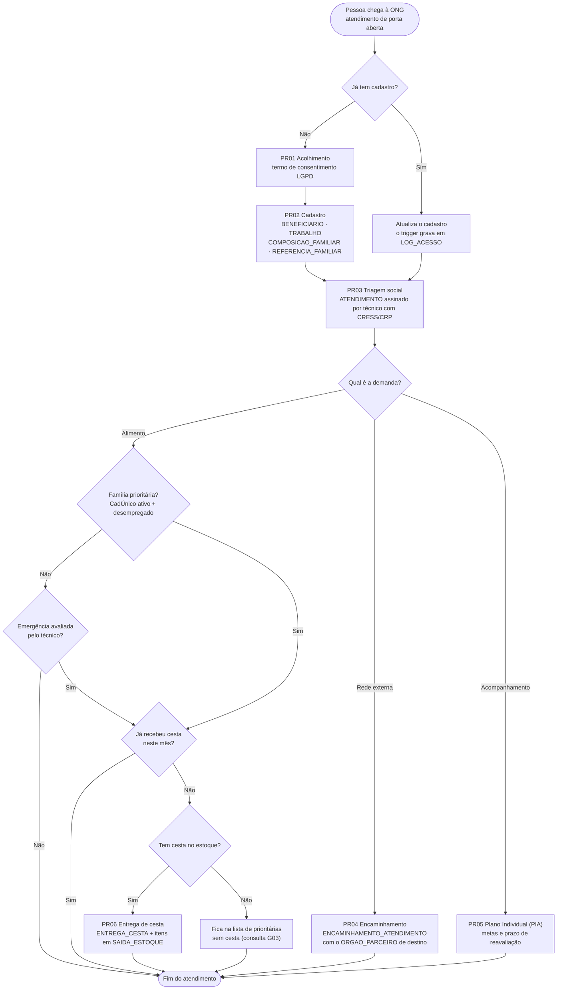
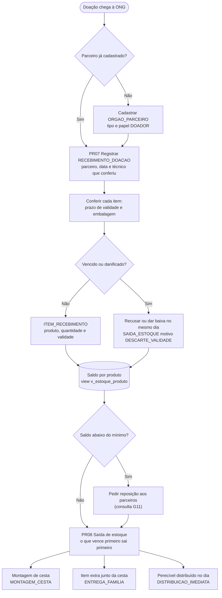
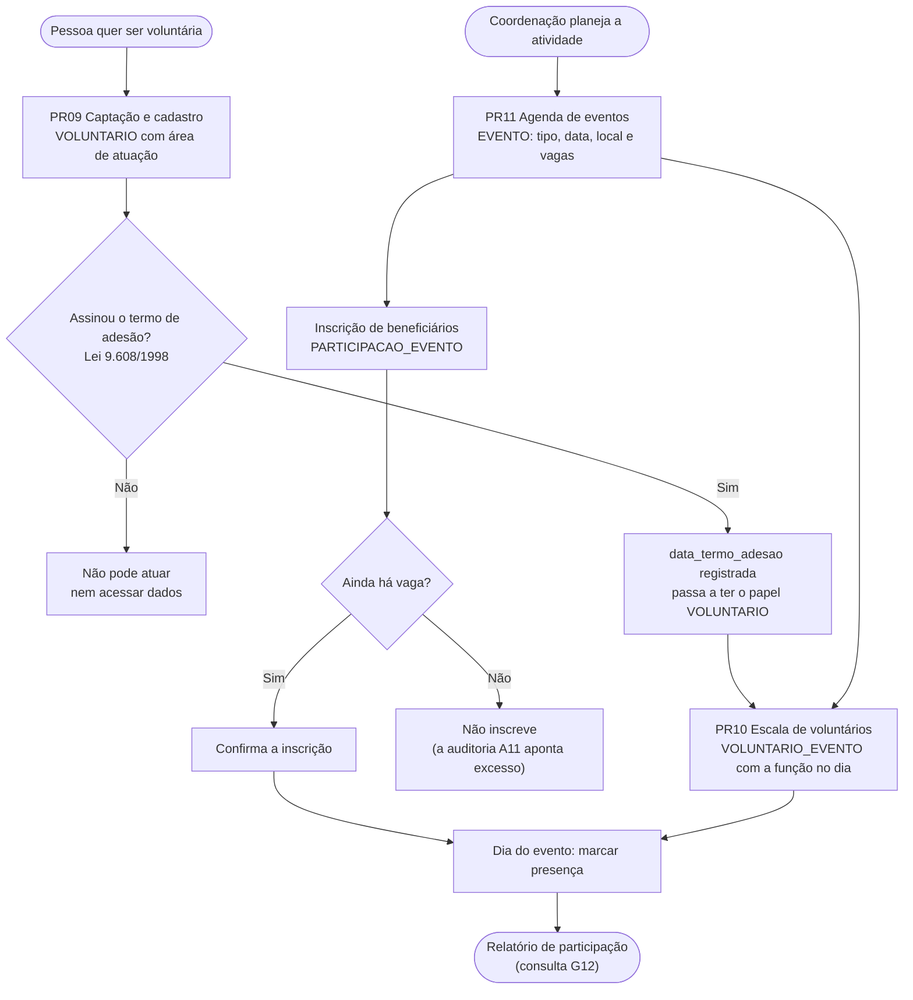
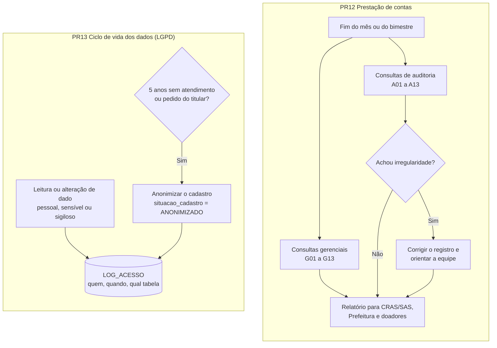
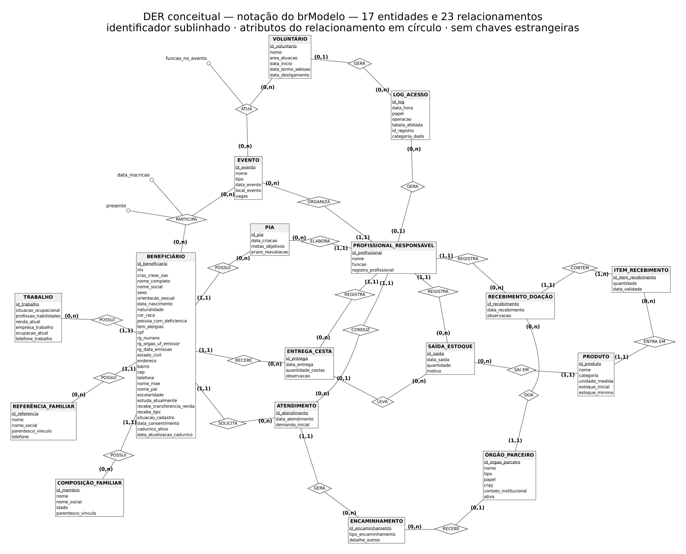
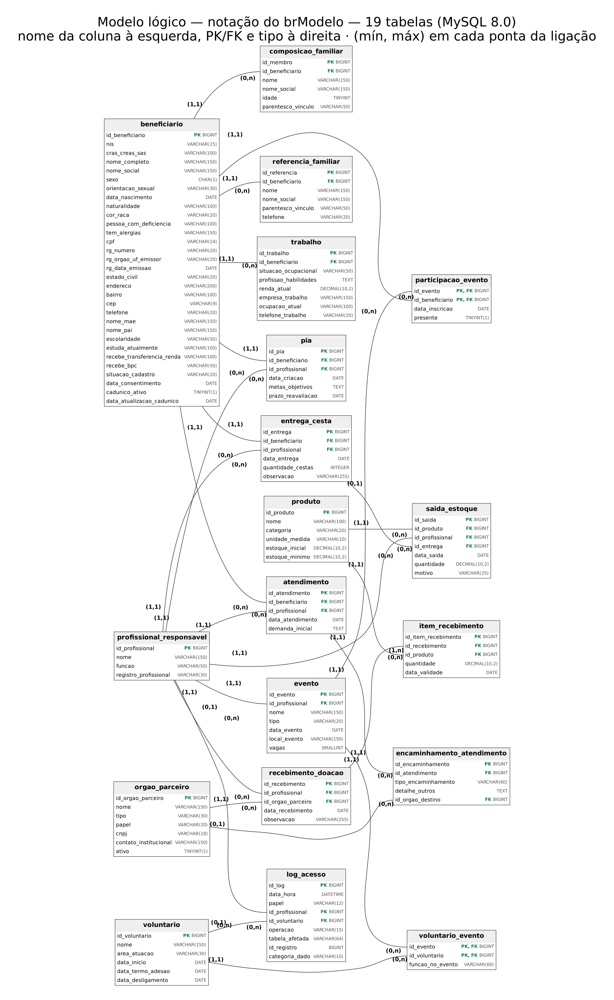

# Banco de Dados da Organização Social Nossa Senhora de Fátima

**Entrega 2 — Do modelo ao banco: modelo lógico, implementação SQL e apresentação final.**
Modelagem de Banco de Dados · Turmas de 2026-2 · Prof. Cid Andrade

[](https://github.com/novaishenrique/projeto-banco-de-dados-ong/actions/workflows/ci-cd.yml)

| Integrante | RGM | Usuário no GitHub |
| :--- | :--- | :--- |
| Gabriel Simões da Silva | 4732733 | [Gabriel-Simoes2006](https://github.com/Gabriel-Simoes2006) |
| Henrique Novais de Oliveira | 47046996 | [novaishenrique](https://github.com/novaishenrique) |
| Leandro Miranda da Silva | 47397349 | [mirandaleandro-creator](https://github.com/mirandaleandro-creator) |
| Mateus Alves dos Santos | 47435887 | [mateusalvesantos2025-dev](https://github.com/mateusalvesantos2025-dev) |
| Washington de Souza Silva | 49080156 | [washingtondesouzasilva1980-collab](https://github.com/washingtondesouzasilva1980-collab) |

**▶️ Vídeo de apresentação:** [defesa do modelo lógico, do papel ao banco de dados, com a demonstração das consultas no MySQL Workbench](https://youtu.be/smOM2vWxMVs?is=0PQ62R1Ruaz3v9Fb).

> 📌 A organização da Entrega 1 é real (Caso A): o grupo continua com ela e revisou o DER a partir da [correção do professor](https://github.com/mateusalvesantos2025-dev/projeto-banco-de-dados-ong/issues/1). Repositório da Entrega 1: [projeto-banco-de-dados-ong](https://github.com/mateusalvesantos2025-dev/projeto-banco-de-dados-ong).
>
> 🔒 Os dados de beneficiários, voluntários e equipe usados no banco são **fictícios**. O único contato real é o da responsável que atendeu o grupo, exigido pelo modelo de entrega (seção 1.1.2).

---

## Sumário

| Parte | Seção | Arquivo separado |
| :--- | :--- | :--- |
| 1. A organização e o modelo conceitual | [1.1 Revisão da organização e do DER](#11-a-organização-e-o-modelo-conceitual-revisão) | [`levantamento/levantamento.md`](levantamento/levantamento.md) · [`diagrama-der.jpg`](diagrama-der.jpg) |
| 2. Do conceitual ao relacional | [1.2 Conversão](#12-conversão-do-conceitual-para-o-lógico) · [1.3 Dicionário](#13-dicionário-de-dados) · [1.4 Normalização](#14-normalização) · [1.5 Justificativas](#15-justificativas) · [1.6 BI e IA](#16-bi-e-ia) · [2. Modelo lógico](#2-modelo-lógico) | [`dicionario.md`](dicionario.md) · [`modelo-logico.jpg`](modelo-logico.jpg) |
| 3. Implementação e repositório | [3. Script SQL](#3-script-sql) · [4. Massa de dados](#4-massa-de-dados) · [5. Repositório](#5-repositório) · [6. Uso de IA](#6-uso-de-ia) | [`SQL/script.sql`](SQL/script.sql) · [`SQL/massa-dados.sql`](SQL/massa-dados.sql) |
| 4. Apresentação final | [7. Pitch de 8 minutos](#7-apresentação-pitch-de-8-minutos) | |

---

## 1.1 A organização e o modelo conceitual (revisão)

### 1.1.1 Caracterização da organização

| Item | Informação |
| :--- | :--- |
| Nome | Organização Social Nossa Senhora de Fátima |
| CNPJ | 32.667.614/0001-18 |
| Endereço | Rua Guaimbé, 161 — Mooca, São Paulo - SP |
| Site | [ongnossasenhoradefatima.com.br](http://www.ongnossasenhoradefatima.com.br) |
| Google Meu Negócio | [Busca no Google Maps pelo nome e endereço](https://www.google.com/maps/search/?api=1&query=Organiza%C3%A7%C3%A3o+Social+Nossa+Senhora+de+F%C3%A1tima+Rua+Guaimb%C3%A9+161+Mooca+S%C3%A3o+Paulo) |
| Fotos da visita | 5 fotos JPG em [`levantamento/`](levantamento/levantamento.md#4-fotos-da-visita) |

**Porte em números** (informado na entrevista de 12/09/2026):

| Indicador | Valor |
| :--- | ---: |
| Famílias cadastradas e atendidas | cerca de **250** |
| Lote de cestas básicas da Prefeitura | **150 cestas a cada 2 meses** (75 por mês, em média) |
| Equipe técnica | **1** assistente social |
| Diretoria | **1** presidente |
| Voluntários recorrentes | **5** |
| Parceiros doadores citados | **4** (Prefeitura, Banco de Alimentos, Projeto Cidade Invisível e doadores particulares) |
| Limite da ficha de cadastro em papel | até **5** moradores e **3** contatos de emergência por família |

**O que a ONG faz:** atende de **porta aberta** pessoas em vulnerabilidade social da região da Mooca. A assistente social faz a triagem e, a partir dela, a família recebe cesta básica, é encaminhada para a rede pública (saúde e saúde mental, habitação, assistência jurídica e outros) ou entra em acompanhamento pelo Plano Individual de Atendimento (PIA). A ONG recebe doações de mantimentos, organiza passeios e atividades nos fins de semana com voluntários e presta contas à Prefeitura, ao CRAS/SAS e aos doadores.

**Por que esta organização:** é real e acessível (o grupo visitou, entrevistou a equipe e viu a ficha em papel), o problema é de dados (tudo é registrado à mão) e o domínio tem regras de verdade para modelar: elegibilidade de cestas, lote da Prefeitura, validade de alimentos, sigilo profissional e LGPD.

**Escopo:** o modelo cobre **todos os dados da operação descritos na visita**: cadastro, triagem, encaminhamentos, PIA, cestas, doações, estoque, voluntários, eventos, prestação de contas e controle de acesso. O que ficou de fora e por quê está na [seção 1.1.8](#118-o-típico-e-o-que-ficou-fora).

### 1.1.2 Quem responde pela organização

| Item | Informação |
| :--- | :--- |
| Quem atendeu o grupo | **Maria Aparecida Fernandes Ferreira de Souza**, assistente social responsável |
| Telefone | (11) 96972-4382 |
| Vínculo de integrante do grupo | **Declarado:** Washington de Souza Silva, integrante do grupo, é **presidente da ONG**. O acesso à organização veio por ele |
| Como o vínculo foi tratado | A entrevista técnica foi feita **também com a assistente social**, que não é do grupo; o modelo foi conferido contra a **ficha em papel**; nenhum dado real de beneficiário foi usado |

### 1.1.3 Relato da entrevista e levantamento

O relato completo, escrito pelo grupo, está em [`levantamento/levantamento.md`](levantamento/levantamento.md). Resumo:

**No local**

| Item | Registro |
| :--- | :--- |
| Data e local | 12/09/2026, das 11h00 às 14h30, na sede da ONG (Rua Guaimbé, 161, Mooca) |
| Entrevistados | A assistente social responsável e o presidente da ONG |
| Participantes | Integrantes do grupo (registrados nas fotos da visita) |
| Etapas | 1) reconhecimento do espaço; 2) conversa sobre o funcionamento; 3) entrevista técnica com o roteiro do grupo |
| Evidências | 5 fotos JPG no repositório: sala da equipe técnica, fachada da ONG e da Loja Social e o grupo com a equipe |

**Observação presencial (o que o grupo viu, separado do que foi dito)**

| O que foi **dito** | O que o grupo **viu** | Consequência no modelo |
| :--- | :--- | :--- |
| O cadastro e a triagem são feitos em ficha de papel | Papéis e documentos sobre a mesa da sala de atendimento | Ficha digitalizada em `beneficiario`, `trabalho`, `composicao_familiar`, `referencia_familiar` e `atendimento` |
| Os mantimentos ficam guardados na ONG até a entrega | Espaço de armazenamento de mantimentos e doações | Estoque item a item: `produto`, `item_recebimento`, `saida_estoque` |
| A ONG atende de porta aberta | Recepção aberta para a rua, sem agendamento | Não há tabela de agenda de atendimentos (seção 1.1.8) |
| A entrevista não tratou da Loja Social | Fachada com a placa **"Loja Social"** | Fora do modelo até uma nova visita (seção 1.1.8) |

### 1.1.4 Problemas (P1 a P10)

Todos os problemas são resolvidos pelo modelo e têm ao menos uma consulta no script ([rastreabilidade na seção 1.6.4](#164-rastreabilidade-problema--tabelas--consulta)).

| # | Problema | Como o modelo resolve |
| :---: | :--- | :--- |
| P1 | Histórico das famílias espalhado em fichas de papel: busca lenta, risco de perda | Cadastro único com todos os atendimentos, encaminhamentos, cestas e PIA ligados ao titular |
| P2 | Sem controle de quem recebeu cesta e quando: duplicidade e família prioritária sem cesta | `entrega_cesta` com data e responsável; prioridade (CadÚnico + desemprego) e periodicidade auditadas |
| P3 | Doações recebidas e cestas entregues não são consolidadas para a prestação de contas | `recebimento_doacao` + `item_recebimento` por parceiro, comparados com as entregas |
| P4 | Encaminhamentos à rede externa sem registro nem estatística | `encaminhamento_atendimento` com o órgão de destino |
| P5 | PIA sem controle do prazo de reavaliação | `pia.prazo_reavaliacao` e consultas de vencidos |
| P6 | Dados sensíveis em papel, sem controle de consentimento e de prazo de guarda | `data_consentimento`, `situacao_cadastro` e anonimização após 5 anos |
| P7 | Relatórios ao CRAS/SAS montados à mão | Consultas prontas de volume e perfil |
| P8 | Estoque sem saldo nem controle de validade | View `v_estoque_produto`, `data_validade` e descarte registrado |
| P9 | Voluntários e eventos sem registro (termo de adesão, vagas, presença) | `voluntario`, `evento`, `participacao_evento`, `voluntario_evento` |
| P10 | Sem rastro de quem acessou dados sensíveis e sigilosos | `log_acesso` e trigger de alteração |

### 1.1.5 Processos de negócio

| # | Processo | Quem faz | O que é registrado (campos) | Regras | Consultas |
| :---: | :--- | :--- | :--- | :---: | :---: |
| PR01 | Acolhimento e termo de consentimento LGPD | Assistente social | `data_consentimento`, `situacao_cadastro` | RN07 | A06 |
| PR02 | Cadastro do titular, da família e dos contatos | Assistente social | Titular (31 campos, RF01); moradores: `nome`, `nome_social`, `idade`, `parentesco_vinculo`; contatos: `nome`, `nome_social`, `parentesco_vinculo`, `telefone` | RN01, RN10 | G09, A07 |
| PR03 | Triagem socioassistencial | Assistente social | `data_atendimento`, `demanda_inicial`, profissional; trabalho e renda (RF02) | RN03, RN11 | G05, A08 |
| PR04 | Encaminhamento à rede externa | Assistente social | `tipo_encaminhamento`, `detalhe_outros`, órgão de destino | RN18 | G06 |
| PR05 | Acompanhamento pelo PIA | Assistente social | `data_criacao`, `metas_objetivos`, `prazo_reavaliacao` | RN04 | G07, G08 |
| PR06 | Concessão e entrega de cestas | Assistente social | `data_entrega`, `quantidade_cestas`, `observacao`; itens extras em `saida_estoque` | RN05, RN06 | G02 a G04, A01 a A03 |
| PR07 | Captação e recebimento de doações | Assistente social ou presidência | Parceiro (`nome`, `tipo`, `papel`, `cnpj`, `contato_institucional`, `ativo`); doação (`data_recebimento`, `observacao`); itens (`quantidade`, `data_validade`) | RN09, RN12 | G10, A10 |
| PR08 | Controle de estoque | Assistente social ou voluntário | Produto (`nome`, `categoria`, `unidade_medida`, `estoque_inicial`, `estoque_minimo`); saída (`data_saida`, `quantidade`, `motivo`) | RN13, RN14 | G11, A09 |
| PR09 | Captação e cadastro de voluntários | Presidência | `nome`, `area_atuacao`, `data_inicio`, `data_termo_adesao`, `data_desligamento` | RN15 | A12 |
| PR10 | Escala de voluntários nos eventos | Presidência | `funcao_no_evento` | RN15 | G12, A12 |
| PR11 | Agenda de eventos e das reavaliações do PIA | Presidência e assistente social | Evento (`nome`, `tipo`, `data_evento`, `local_evento`, `vagas`); inscrição (`data_inscricao`, `presente`); `prazo_reavaliacao` | RN04, RN16 | G07, G12, A11 |
| PR12 | Prestação de contas (CRAS/SAS, Prefeitura e doadores) | Presidência | Somente leitura | RN08 | G01 a G13, A01 a A13 |
| PR13 | Controle de acesso e ciclo de vida dos dados | Sistema e assistente social | `data_hora`, `papel`, `operacao`, `tabela_afetada`, `id_registro`, `categoria_dado` | RN02, RN07, RN17 | G13, A05, A13 |

**Fluxo 1 — Atendimento socioassistencial (PR01 a PR06)**



**Fluxo 2 — Doações e estoque (PR07 e PR08)**



**Fluxo 3 — Voluntários e eventos (PR09 a PR11)**



**Fluxo 4 — Prestação de contas e LGPD (PR12 e PR13)**



### 1.1.6 Requisitos funcionais e não funcionais

Os códigos RF01 a RF06 e RNF01 a RNF06 são os da Entrega 1. Os novos continuam a numeração.

| # | O sistema deve... |
| :---: | :--- |
| RF01 | **Cadastrar o beneficiário** com `nis`, `cras_creas_sas`, `nome_completo`, `nome_social`, `sexo`, `orientacao_sexual`, `data_nascimento`, `naturalidade`, `cor_raca`, `pessoa_com_deficiencia`, `tem_alergias`, `cpf`, `rg_numero`, `rg_orgao_uf_emissor`, `rg_data_emissao`, `estado_civil`, `endereco`, `bairro`, `cep`, `telefone`, `nome_mae`, `nome_pai`, `escolaridade`, `estuda_atualmente`, `recebe_transferencia_renda`, `recebe_bpc`, `cadunico_ativo`, `data_atualizacao_cadunico`, `data_consentimento` e `situacao_cadastro`; os **moradores** (`nome`, `nome_social`, `idade`, `parentesco_vinculo`) e os **contatos de emergência** (`nome`, `nome_social`, `parentesco_vinculo`, `telefone`), sem CPF ou NIS repetido |
| RF02 | **Registrar a triagem**: situação de trabalho (`situacao_ocupacional`, `profissao_habilidades`, `renda_atual`, `empresa_trabalho`, `ocupacao_atual`, `telefone_trabalho`) e o atendimento (`data_atendimento`, `demanda_inicial`, profissional responsável) |
| RF03 | **Registrar encaminhamentos** de cada atendimento: `tipo_encaminhamento`, `detalhe_outros` e o órgão de destino |
| RF04 | **Registrar a concessão de cestas**: família, `data_entrega`, `quantidade_cestas`, `observacao` (justificativa de exceção) e quem autorizou |
| RF05 | **Registrar o PIA**: família, profissional, `data_criacao`, `metas_objetivos` e `prazo_reavaliacao` |
| RF06 | **Consultar o histórico** completo de uma família: atendimentos, encaminhamentos, cestas e PIA |
| RF07 | **Cadastrar parceiros** (`nome`, `tipo`, `papel`, `cnpj`, `contato_institucional`, `ativo`) e **registrar doações** (`data_recebimento`, `observacao`, quem conferiu) item a item (`produto`, `quantidade`, `data_validade`) |
| RF08 | **Controlar o estoque**: catálogo (`nome`, `categoria`, `unidade_medida`, `estoque_inicial`, `estoque_minimo`), saídas (`data_saida`, `quantidade`, `motivo`, entrega ligada), saldo e alerta de mínimo |
| RF09 | **Cadastrar voluntários**: `nome`, `area_atuacao`, `data_inicio`, `data_termo_adesao`, `data_desligamento` |
| RF10 | **Agendar eventos** (`nome`, `tipo`, `data_evento`, `local_evento`, `vagas`, responsável), inscrever beneficiários (`data_inscricao`, `presente`) e montar a escala de voluntários (`funcao_no_evento`) |
| RF11 | **Emitir os relatórios** de prestação de contas (G01 a G13) e de auditoria (A01 a A13) |
| RF12 | **Registrar acessos** (`data_hora`, `papel`, autor, `operacao`, `tabela_afetada`, `id_registro`, `categoria_dado`) e **anonimizar** cadastros no fim do prazo |

| # | Requisito não funcional |
| :---: | :--- |
| RNF01 | **Segurança e LGPD:** acesso por papel (`TECNICO`, `ADMIN`, `VOLUNTARIO`), conforme a matriz do [dicionário](dicionario.md#04-papéis-e-permissões) |
| RNF02 | **Desempenho:** busca por CPF, NIS ou nome em até 2 segundos, com índices nessas colunas |
| RNF03 | **Integridade:** PK, FK, `CHECK` e `ON DELETE RESTRICT`; registro com histórico não é apagado |
| RNF04 | **Disponibilidade:** funcionar no horário de atendimento, com backup diário |
| RNF05 | **Usabilidade:** telas simples para a recepção e para a equipe técnica |
| RNF06 | **Auditoria:** data, hora, usuário e operação em `log_acesso` |
| RNF07 | **Padronização:** MySQL 8.0, `utf8mb4`, nomes em `snake_case`, script versionado e testado a cada push |

### 1.1.7 Regras de negócio (RN)

RN01 a RN11 são os códigos da Entrega 1. Cada regra cita os campos que controla e onde o banco a garante. Quando o MySQL não consegue garantir sozinho (contar linhas antes de inserir), a aplicação confere e uma consulta de auditoria aponta o que escapou.

| # | Regra (campos) | Por quê | Onde é garantida |
| :---: | :--- | :--- | :--- |
| RN01 | Um só cadastro por pessoa: `cpf` (`000.000.000-00`) e `nis` (11 dígitos) são opcionais, mas únicos; `cep` com 8 dígitos; `rg_data_emissao` não antes de `data_nascimento`; `sexo` F, M ou O | Evitar duplicidade sem negar atendimento a quem não tem documento | `uq_beneficiario_cpf`, `uq_beneficiario_nis` e os `CHECK` de formato |
| RN02 | `cor_raca`, `orientacao_sexual`, `pessoa_com_deficiencia`, `tem_alergias` (sensíveis) e `renda_atual`, `demanda_inicial`, `metas_objetivos` (sigilosos) só são vistos pela equipe técnica | Sigilo profissional e LGPD (art. 11) | Matriz de papéis do dicionário, `log_acesso.categoria_dado` e auditoria **A13** |
| RN03 | Sem triagem (`atendimento`), não há cesta, encaminhamento nem PIA | O auxílio vai para quem foi avaliado | FK obrigatória `encaminhamento_atendimento.id_atendimento`; cesta sem triagem anterior aparece na **A01** |
| RN04 | Todo PIA tem `metas_objetivos` e `prazo_reavaliacao`, que não pode ser anterior a `data_criacao` | Acompanhar a evolução da família | `ck_pia_prazo`; vencidos nas consultas **G07** e **G08** |
| RN05 | As cestas vêm do lote de 150 da Prefeitura a cada 2 meses e de doações esporádicas; `quantidade_cestas` > 0 | Saber a origem de cada cesta | Doação ligada a `orgao_parceiro` do tipo `PREFEITURA`; `ck_entrega_quantidade`; taxa de distribuição na **G02** |
| RN06 | **Elegibilidade e periodicidade:** prioridade para `cadunico_ativo` = 1 com `data_atualizacao_cadunico` nos últimos 24 meses e `situacao_ocupacional` "Desempregado(a)"; no máximo **uma entrega por família por mês**; exceção só por emergência, escrita em `observacao` | Recursos limitados vão para quem mais precisa, sem duplicar | Consultas **G03** e **G04**; auditorias **A02**, **A03** e **A04** |
| RN07 | **Consentimento e retenção:** `data_consentimento` antes do primeiro atendimento; após 5 anos sem atendimento, ou a pedido do titular, `situacao_cadastro` = `ANONIMIZADO` | LGPD (art. 7º, 11, 15 e 16) | `data_consentimento NOT NULL`, `ck_beneficiario_situacao`; anonimização na seção 6.3 do script; auditorias **A05** e **A06** |
| RN08 | O sistema gera os relatórios para CRAS/SAS, Prefeitura e doadores | Prestação de contas | Consultas **G01** a **G13** |
| RN09 | **Validade dos alimentos:** todo item tem `data_validade` conferida na chegada; item vencido é recusado ou descartado no mesmo dia | Segurança alimentar | `item_recebimento.data_validade`; auditoria **A10** |
| RN10 | No máximo 5 moradores (`composicao_familiar`) e 3 contatos (`referencia_familiar`) por família; `idade` entre 0 e 120 | Segue o formato da ficha em papel | Aplicação, `ck_composicao_idade`; auditoria **A07** |
| RN11 | Todo atendimento, PIA, entrega e doação tem um profissional com `registro_profissional` (CRESS ou CRP), único | Responsabilidade técnica | FKs obrigatórias para `profissional_responsavel`, `uq_profissional_registro`; auditoria **A08** |
| RN12 | Toda doação tem parceiro de origem e pelo menos um item com `quantidade` > 0; parceiro com `nome` e `cnpj` únicos | Rastrear de onde veio cada produto | `fk_recebimento_orgao` (NOT NULL), `ck_item_recebimento_qtd`, `uq_orgao_nome`, `uq_orgao_cnpj` |
| RN13 | Saldo = `estoque_inicial` + entradas − saídas; só sai o que entrou; item que vai para uma família aponta a entrega (`id_entrega`) | Saldo confiável | View `v_estoque_produto`, `ck_saida_entrega`; auditoria **A09** |
| RN14 | Sai primeiro o que vence primeiro; descarte é registrado com `motivo` = `DESCARTE_VALIDADE` | Evitar perda e provar o descarte | `ck_saida_motivo`; próxima validade na **G11** |
| RN15 | Voluntário só atua depois da `data_termo_adesao` e até a `data_desligamento` | Lei 9.608/1998 | `data_termo_adesao NOT NULL`, `ck_voluntario_datas`; auditoria **A12** |
| RN16 | Um evento não pode ter mais inscritos que `vagas` (> 0); `presente` é 0 ou 1 | Segurança e organização dos passeios | `ck_evento_vagas`, `ck_participacao_presente`; aplicação; auditoria **A11** |
| RN17 | Todo acesso a dado pessoal, sensível ou sigiloso é registrado, com **um único autor** (profissional ou voluntário) e o `papel` coerente | Rastreabilidade exigida pela LGPD | `log_acesso`, trigger `trg_beneficiario_log_alteracao`, `ck_log_um_ator`, `ck_log_papel_ator`; consultas **G13** e **A13** |
| RN18 | Encaminhamento aponta o órgão de destino; tipo "Outros" exige `detalhe_outros` | Medir a rede externa e cobrar retorno | `fk_encaminhamento_orgao`, `ck_encaminhamento_outros`; consulta **G06** |

### 1.1.8 O típico e o que ficou fora

O grupo comparou o levantamento com o que é típico de uma organização socioassistencial, a partir da Tipificação Nacional dos Serviços Socioassistenciais, do Marco Regulatório das OSCs (Lei 13.019/2014), das regras de inscrição de entidades nos conselhos de assistência social e de pesquisa com IA (registrada na [seção 6](#6-uso-de-ia)).

| Processo típico | No modelo? | Justificativa |
| :--- | :---: | :--- |
| Acolhimento, cadastro, triagem e encaminhamento | ✅ | PR01 a PR04 |
| Acompanhamento familiar (PIA) | ✅ | PR05 |
| Concessão de benefícios eventuais (cestas) | ✅ | PR06 |
| Captação de doações e controle de estoque | ✅ | PR07 e PR08 |
| Gestão de voluntários | ✅ | PR09 e PR10 (Lei 9.608/1998) |
| Atividades socioeducativas e passeios | ✅ | PR11 |
| Prestação de contas a doadores e órgãos públicos | ✅ | PR12 (consultas G e A) |
| Agenda de atendimentos com hora marcada | ❌ | A ONG atende de **porta aberta**, sem agendamento (dito e visto na visita) |
| Loja Social | ❌ | Vista na fachada, mas **não foi levantada** na entrevista. Fica fora até uma nova visita |
| Parceria com repasse financeiro (termo de colaboração/fomento, MROSC) | ❌ | Não foi citada na visita. O lote da Prefeitura chega como **cestas**, e é registrado como doação |
| Doações em dinheiro, contabilidade e folha de pagamento | ❌ | Não fazem parte da rotina descrita pela equipe; as doações citadas são de mantimentos |
| Inscrição e renovação no conselho municipal de assistência social | ❌ | Processo documental anual, sem dado operacional para o banco |

### 1.1.9 DER revisado

Software: **Graphviz**, gerado por script a partir das entidades do modelo, na **notação do brModelo**: entidade em retângulo com os atributos listados e o **identificador sublinhado**; relacionamento em losango; atributos do relacionamento em círculo; cardinalidade `(mín, máx)` junto de cada entidade; **sem chaves estrangeiras** (elas são do modelo lógico). Não há generalização/especialização (justificativa na [seção 1.2](#12-conversão-do-conceitual-para-o-lógico)).



### 1.1.10 Resposta a cada apontamento da E1

| Apontamento da E1 | O que mudou | Por quê |
| :--- | :--- | :--- |
| Processos de negócio: seção vazia, cobertura de 46% (faltavam captação de doações e de voluntários, estoque, escala, agenda e prestação de contas) | 13 processos (PR01 a PR13), com quem faz, campos, regras e consultas, e 4 fluxogramas | Cada processo levantado precisa ter onde ser registrado no banco |
| Conceitual sem distribuição de cestas e sem o PIA exigido pela RN04 | `ENTREGA_CESTA` e `PIA` no DER, ligadas a BENEFICIÁRIO e PROFISSIONAL | São o principal auxílio e o acompanhamento que a ONG faz |
| Regras de negócio: cobertura de 45% (faltavam elegibilidade e periodicidade das cestas, validade dos alimentos, consentimento e retenção) | 18 regras, cada uma com os campos e onde é garantida; RN06, RN07 e RN09 reescritas | Regra sem lugar no banco não é cumprida |
| Dicionário sem fluxo de dados, convenções, notação, tipos físicos, índices, log de acesso, papéis e retenção; TRABALHO sem cobertura | [`dicionario.md`](dicionario.md) refeito para as 19 tabelas, com essas seções e com TRABALHO | Os itens são exigidos pela correção |
| DER com `(1,n)` nos dois lados, contradizendo o dicionário | Cada ponta tem o mínimo e o máximo da regra de negócio; só PARTICIPA e ATUA são N:N | `(1,n)` dos dois lados diria, por exemplo, que um trabalho pertence a vários beneficiários |
| DER com chaves estrangeiras mal representadas | Removidas do DER; ficam só no modelo lógico | FK é decisão do lógico, não do conceitual |
| DER sem PIA e sem entrega de cestas | Incluídas | Entidades essenciais apontadas na correção |
| Entidades desejáveis ausentes: ÓRGÃO PARCEIRO, VOLUNTÁRIO e EVENTO/PASSEIO | Incluídas, mais PRODUTO, ITEM_RECEBIMENTO, SAÍDA_ESTOQUE e LOG_ACESSO | Cobrem doações, estoque, voluntariado, eventos e LGPD |
| Justificativa: cardinalidades descritas, mas não defendidas | Cada uma das 23 relações tem a defesa do mínimo e do máximo ([seção 1.5.2](#152-chaves-estrangeiras-e-cardinalidades)) | O mínimo decide se a FK é obrigatória |
| Uso de IA sem justificativa da ferramenta final e sem detalhar a resposta | Registro por etapa: ferramenta, motivação, prompt, resposta, verificação, rejeições e reflexão ([seção 6](#6-uso-de-ia)) | Exigido pelo modelo da entrega |
| Caracterização: justificativa do tema só implícita | Parágrafo "Por que esta organização" ([seção 1.1.1](#111-caracterização-da-organização)) | Tornar a escolha explícita |
| Observação: conflito de interesse (acesso por um integrante) | Vínculo declarado e entrevista feita também com a assistente social ([seção 1.1.2](#112-quem-responde-pela-organização)) | O vínculo não dispensa a entrevista |

---

## 1.2 Conversão do conceitual para o lógico

| Elemento do DER | Regra de conversão | Resultado |
| :--- | :--- | :--- |
| 17 entidades | Cada entidade vira uma tabela | 17 tabelas |
| Atributos | Cada atributo vira uma coluna com tipo físico | Ex.: textos em `VARCHAR`, datas em `DATE`, valores em `DECIMAL(10,2)`, sim/não em `TINYINT(1)` |
| Identificador | Vira a PK, sintética (`id_<tabela>`, `BIGINT UNSIGNED AUTO_INCREMENT`) | 17 PKs simples |
| Relacionamento 1:N | A FK vai para a tabela do lado N | 21 FKs (R01 a R19, R22 e R23) |
| Mínimo 1 do lado "1" | FK `NOT NULL` | Ex.: todo atendimento tem beneficiário e profissional |
| Mínimo 0 do lado "1" | FK opcional | R07 (órgão de destino), R17 (entrega da saída), R22 e R23 (autor do log) |
| Relacionamento N:N | Vira tabela associativa com PK composta pelas duas FKs; os atributos do relacionamento viram colunas | `participacao_evento` (R20) e `voluntario_evento` (R21): 2 tabelas e 4 FKs |
| Relacionamento 1:1 | — | Não há no modelo |
| Atributos multivalorados da ficha (moradores e contatos) | Já foram modelados como entidades no DER | `composicao_familiar` e `referencia_familiar` |
| Atributo composto (endereço) | Decomposto em colunas | `endereco` (logradouro e número), `bairro`, `cep` |
| Generalização / especialização | Não usada | ÓRGÃO_PARCEIRO doador e rede de encaminhamento têm os mesmos atributos, então o papel é a coluna `papel` (`DOADOR`, `REDE_ENCAMINHAMENTO`, `AMBOS`). Juntar beneficiário, profissional e voluntário numa PESSOA genérica foi rejeitado (atributos e regras LGPD diferentes) |

**Total:** 17 + 2 = **19 tabelas**, 19 PKs e **25 FKs**.

| # | Relacionamento | Cardinalidade | No modelo lógico |
| :---: | :--- | :---: | :--- |
| R01 | BENEFICIÁRIO possui TRABALHO | (1,1) : (0,n) | `trabalho.id_beneficiario` NOT NULL |
| R02 | BENEFICIÁRIO possui COMPOSIÇÃO_FAMILIAR | (1,1) : (0,n) | `composicao_familiar.id_beneficiario` NOT NULL |
| R03 | BENEFICIÁRIO possui REFERÊNCIA_FAMILIAR | (1,1) : (0,n) | `referencia_familiar.id_beneficiario` NOT NULL |
| R04 | BENEFICIÁRIO solicita ATENDIMENTO | (1,1) : (0,n) | `atendimento.id_beneficiario` NOT NULL |
| R05 | PROFISSIONAL conduz ATENDIMENTO | (1,1) : (0,n) | `atendimento.id_profissional` NOT NULL |
| R06 | ATENDIMENTO gera ENCAMINHAMENTO | (1,1) : (0,n) | `encaminhamento_atendimento.id_atendimento` NOT NULL |
| R07 | ÓRGÃO_PARCEIRO recebe ENCAMINHAMENTO | (0,1) : (0,n) | `encaminhamento_atendimento.id_orgao_destino` opcional |
| R08 | BENEFICIÁRIO possui PIA | (1,1) : (0,n) | `pia.id_beneficiario` NOT NULL |
| R09 | PROFISSIONAL elabora PIA | (1,1) : (0,n) | `pia.id_profissional` NOT NULL |
| R10 | BENEFICIÁRIO recebe ENTREGA_CESTA | (1,1) : (0,n) | `entrega_cesta.id_beneficiario` NOT NULL |
| R11 | PROFISSIONAL registra ENTREGA_CESTA | (1,1) : (0,n) | `entrega_cesta.id_profissional` NOT NULL |
| R12 | ÓRGÃO_PARCEIRO doa RECEBIMENTO_DOAÇÃO | (1,1) : (0,n) | `recebimento_doacao.id_orgao_parceiro` NOT NULL |
| R13 | PROFISSIONAL registra RECEBIMENTO_DOAÇÃO | (1,1) : (0,n) | `recebimento_doacao.id_profissional` NOT NULL |
| R14 | RECEBIMENTO_DOAÇÃO contém ITEM_RECEBIMENTO | (1,1) : (1,n) | `item_recebimento.id_recebimento` NOT NULL |
| R15 | PRODUTO entra em ITEM_RECEBIMENTO | (1,1) : (0,n) | `item_recebimento.id_produto` NOT NULL |
| R16 | PRODUTO sai em SAÍDA_ESTOQUE | (1,1) : (0,n) | `saida_estoque.id_produto` NOT NULL |
| R17 | ENTREGA_CESTA leva SAÍDA_ESTOQUE | (0,1) : (0,n) | `saida_estoque.id_entrega` opcional |
| R18 | PROFISSIONAL registra SAÍDA_ESTOQUE | (1,1) : (0,n) | `saida_estoque.id_profissional` NOT NULL |
| R19 | PROFISSIONAL organiza EVENTO | (1,1) : (0,n) | `evento.id_profissional` NOT NULL |
| R20 | BENEFICIÁRIO participa EVENTO | (0,n) : (0,n) | Associativa `participacao_evento` (PK `id_evento` + `id_beneficiario`) |
| R21 | VOLUNTÁRIO atua EVENTO | (0,n) : (0,n) | Associativa `voluntario_evento` (PK `id_evento` + `id_voluntario`) |
| R22 | PROFISSIONAL gera LOG_ACESSO | (0,1) : (0,n) | `log_acesso.id_profissional` opcional |
| R23 | VOLUNTÁRIO gera LOG_ACESSO | (0,1) : (0,n) | `log_acesso.id_voluntario` opcional |

---

## 1.3 Dicionário de dados

Um único arquivo: [`dicionario.md`](dicionario.md). Para cada uma das 19 tabelas: atributo, descrição, tipo físico, chave, obrigatoriedade, classe LGPD e regra de negócio. Também traz as convenções, a notação, a classificação LGPD, os papéis e permissões, a retenção, o log de acesso, os índices e o fluxo de dados. É lá que ficam `NOT NULL`, `UNIQUE`, `CHECK` e `DEFAULT`, que não aparecem no diagrama do brModelo.

---

## 1.4 Normalização

| Forma normal | O que exige | Onde foi necessária neste modelo e por quê |
| :--- | :--- | :--- |
| **1FN** | Valores atômicos, sem listas dentro de uma coluna | A ficha em papel tem **listas** de moradores e de contatos: viraram `composicao_familiar` e `referencia_familiar`. Na E1, a doação guardava vários itens num texto (`descricao_itens`, `quantidade_total`) e a entrega guardava itens extras em texto (`itens_adicionais`): sem a 1FN não dava para somar, controlar validade nem calcular saldo. Viraram `item_recebimento` e `saida_estoque` |
| **2FN** | Em chave composta, todo atributo depende da chave inteira | Só as associativas têm PK composta. Em `participacao_evento` (`id_evento` + `id_beneficiario`), `data_inscricao` e `presente` dependem do par. O nome, a data e as vagas dependem só do evento, por isso ficam em `evento`; repetir em cada inscrição causaria anomalia de atualização |
| **3FN** | Nenhum atributo depende de outro que não é chave | Na E1, o nome do doador era texto repetido em cada doação (`parceiro_doador`): o tipo e o contato do doador dependiam do doador, não da doação. Virou `orgao_parceiro`. O **saldo** do estoque não é guardado, porque depende das entradas e saídas: é calculado na view `v_estoque_produto`. A idade do titular é calculada pela `data_nascimento` |

---

## 1.5 Justificativas

### 1.5.1 Chaves primárias

- Todas as PKs são **sintéticas** (`id_<tabela>`, `BIGINT UNSIGNED AUTO_INCREMENT`). CPF e NIS **não** são PK porque quem chega sem documento precisa ser atendido (RN01); eles são `UNIQUE` opcionais.
- As associativas `participacao_evento` e `voluntario_evento` usam **PK composta** pelas duas FKs, o que já impede inscrever a mesma pessoa duas vezes no mesmo evento.

### 1.5.2 Chaves estrangeiras e cardinalidades

Para cada relação, duas perguntas: **o mínimo** ("um lado pode existir sem o outro?") e **o máximo** ("pode haver mais de um?"). O mínimo 1 vira FK `NOT NULL`; o mínimo 0 vira FK opcional. Todas as FKs usam `ON DELETE RESTRICT`: nada com histórico é apagado (RN07).

| # | Por que esse mínimo e esse máximo |
| :---: | :--- |
| R01 | Trabalho não existe sem titular. O titular pode estar sem registro (quem nunca trabalhou) ou ter vários ao longo do tempo |
| R02 | Morador sempre é da família de um titular. Quem mora sozinho tem zero; o limite de 5 é da RN10 |
| R03 | Contato é sempre de um titular. Ter contato não é obrigatório; o limite de 3 é da RN10 |
| R04 | Atendimento é sempre de alguém. O cadastro pode existir antes do primeiro atendimento (acolhimento) |
| R05 | Todo atendimento é assinado (RN11). Profissional recém-cadastrado ainda não tem atendimentos |
| R06 | Encaminhamento só nasce de uma triagem (RN03). A maioria dos atendimentos não gera encaminhamento |
| R07 | O destino pode ser um órgão ainda não cadastrado (tipo "Outros"): mínimo 0. Um encaminhamento vai para um órgão só |
| R08 | Plano é sempre de uma família. Só quem precisa de acompanhamento tem PIA; um novo plano substitui o anterior |
| R09 | Todo plano tem um técnico responsável (RN11) |
| R10 | Entrega é sempre para uma família. Nem toda família recebe cesta |
| R11 | Toda entrega tem quem autorizou (RN11) |
| R12 | Não existe doação sem origem (RN12). Um órgão da rede de encaminhamento nunca doa |
| R13 | Toda doação tem quem conferiu a validade (RN09) |
| R14 | Item não existe fora de uma doação. Doação sem item não faz sentido: mínimo 1 do lado N (conferido na aplicação) |
| R15 | Cada item é de um produto do catálogo. Produto novo ainda não recebeu doação |
| R16 | Cada saída é de um produto |
| R17 | Montagem de cesta e descarte saem sem entrega: mínimo 0. Item que vai para uma família aponta uma entrega só (`ck_saida_entrega`) |
| R18 | Toda saída tem responsável |
| R19 | Todo evento tem responsável |
| R20 | Um evento tem vários participantes e uma pessoa vai a vários eventos. Nenhum lado é obrigatório |
| R21 | Um evento tem vários voluntários e um voluntário trabalha em vários eventos |
| R22 e R23 | Cada linha do log tem **um** autor: profissional **ou** voluntário. Por isso cada FK, sozinha, é opcional, e `ck_log_um_ator` exige exatamente uma das duas |

### 1.5.3 Restrições e regras de negócio

No [`SQL/script.sql`](SQL/script.sql), cada constraint traz no comentário o código da regra que garante.

| Restrição | Tipo | Regra |
| :--- | :---: | :---: |
| `uq_beneficiario_cpf`, `uq_beneficiario_nis`, `ck_beneficiario_cpf_formato`, `ck_beneficiario_nis_formato`, `ck_beneficiario_cep_formato`, `ck_beneficiario_rg_emissao`, `ck_beneficiario_sexo` | UNIQUE / CHECK | RN01 |
| `ck_log_papel`, `ck_log_categoria` | CHECK | RN02 |
| `fk_encaminhamento_atendimento`, `fk_atendimento_beneficiario` | FK | RN03 |
| `ck_pia_prazo`, `fk_pia_beneficiario` | CHECK / FK | RN04 |
| `ck_entrega_quantidade` | CHECK | RN05 |
| `ck_beneficiario_cadunico`, `ck_trabalho_renda`, `fk_entrega_beneficiario` | CHECK / FK | RN06 |
| `ck_beneficiario_situacao`, `data_consentimento NOT NULL` | CHECK / NOT NULL | RN07 |
| `ck_composicao_idade` | CHECK | RN10 |
| `uq_profissional_registro`, FKs para `profissional_responsavel` | UNIQUE / FK | RN11 |
| `fk_recebimento_orgao`, `ck_item_recebimento_qtd`, `uq_orgao_nome`, `uq_orgao_cnpj`, `ck_orgao_*` | FK / CHECK / UNIQUE | RN12 |
| `ck_saida_entrega`, `ck_saida_quantidade`, `ck_produto_*`, `uq_produto_nome`, view `v_estoque_produto` | CHECK / UNIQUE / VIEW | RN13 |
| `ck_saida_motivo` | CHECK | RN14 |
| `ck_voluntario_datas`, `ck_voluntario_area`, `data_termo_adesao NOT NULL` | CHECK / NOT NULL | RN15 |
| `ck_evento_vagas`, `ck_evento_tipo`, `ck_participacao_presente` | CHECK | RN16 |
| `ck_log_um_ator`, `ck_log_papel_ator`, `ck_log_operacao`, trigger `trg_beneficiario_log_alteracao` | CHECK / TRIGGER | RN17 |
| `fk_encaminhamento_orgao`, `ck_encaminhamento_outros` | FK / CHECK | RN18 |

### 1.5.4 Decisões gerais e alternativas rejeitadas

| Decisão | Alternativa rejeitada e por quê |
| :--- | :--- |
| PK sintética | CPF ou NIS como PK: quem chega sem documento ficaria sem cadastro |
| Tabelas separadas para beneficiário, profissional e voluntário | Uma PESSOA genérica: atributos, regras e classes LGPD diferentes, muitas colunas vazias |
| Saldo calculado na view | Saldo como coluna em `produto`: ficaria diferente das entradas e saídas no primeiro erro |
| `ON DELETE RESTRICT` e anonimização | `ON DELETE CASCADE`: apagaria histórico usado na prestação de contas |
| Trigger de log no cadastro do beneficiário | Log só na aplicação: alteração feita direto no banco não deixaria rastro |
| Limites de 5 moradores, 3 contatos e vagas conferidos na aplicação e auditados | `CHECK` no MySQL não consegue contar linhas de outra tabela |

---

## 1.6 BI e IA

### 1.6.1 Informações estratégicas

- **Vulnerabilidade e perfil:** famílias por faixa etária, tamanho, CadÚnico e situação de trabalho (G09).
- **Cestas:** quanto do lote da Prefeitura foi distribuído, para quem e se chegou às famílias prioritárias (G02 a G04).
- **Estoque:** saldo, mínimo e próxima validade de cada produto (G11).
- **Rede externa:** para onde a ONG mais encaminha (G06).
- **Acompanhamento:** PIAs vencidos (G07, G08).
- **Eventos e LGPD:** presença nos eventos (G12) e acessos a dados sensíveis (G13).

### 1.6.2 KPIs

Cada KPI tem fórmula, período, meta e consulta no script. As metas são sugestões para validar com a ONG; os valores são os da massa de dados fictícia.

| KPI | Fórmula | Período | Meta | Consulta | Valor na massa |
| :--- | :--- | :---: | :---: | :---: | :--- |
| KPI1 Distribuição do lote | cestas entregues ÷ cestas recebidas × 100 | Bimestral | 95% a 100% | G02 | 100,7% (jul-ago) e 99,3% (set-out) |
| KPI2 Focalização | cestas para famílias prioritárias ÷ total de cestas × 100 | Bimestral | ≥ 85% | G04 | 82,1% e 79,2% |
| KPI3 Prioritárias sem cesta | nº de famílias prioritárias sem entrega no bimestre | Bimestral | 0 | G03 | 23 famílias em set-out |
| KPI4 Volume de atendimento | atendimentos, pessoas e novos cadastros | Mensal | Acompanhar | G05 | 78 a 94 atendimentos por mês |
| KPI5 Rede externa | encaminhamentos por tipo ÷ total × 100 | No período | Acompanhar | G06 | CRAS e habitação lideram (16,2% cada) |
| KPI6 PIAs vencidos | PIAs com reavaliação vencida ÷ PIAs vigentes × 100 | Na data | ≤ 10% | G08 | 33,3% |
| KPI7 Produtos para repor | nº de produtos com saldo abaixo do mínimo | Semanal | 0 | G11 | 1 (cesta básica, à espera do próximo lote) |
| KPI8 Presença em eventos | presentes ÷ inscritos × 100 | Por evento | ≥ 80% | G12 | 82% a 97% |
| KPI9 Acessos fora do papel | acessos a dado sensível ou sigiloso por quem não é técnico | Mensal | 0 | A13 | 3 |

### 1.6.3 Aplicações analíticas

| Aplicação | O que faz | Fonte |
| :--- | :--- | :--- |
| Painel de cestas e estoque (BI) | Lote recebido x entregue, focalização, saldo e validade | G02 a G04, G10, G11 |
| Painel de atendimento (BI) | Atendimentos por mês, perfil e rede de encaminhamento | G05, G06, G09 |
| Painel de conformidade (BI) | Auditorias A01 a A13 e acessos por papel | G13, A01 a A13 |
| Previsão de demanda de cestas (IA) | Estima as cestas do próximo mês pelo histórico de entregas e pelo tamanho das famílias, para pedir doações com antecedência | `entrega_cesta`, `composicao_familiar` |
| Sugestão de encaminhamento (IA) | Lê `demanda_inicial` e sugere o tipo de encaminhamento; o técnico decide | `atendimento`, `encaminhamento_atendimento` |
| Alerta de vulnerabilidade (IA) | Cruza renda, tamanho da família e ausência de cesta recente | `trabalho`, `composicao_familiar`, `entrega_cesta` |

Qualquer modelo de IA usaria só dados anonimizados ou com base legal, e a decisão final fica com a equipe técnica.

### 1.6.4 Rastreabilidade (problema → tabelas → consulta)

| Problema ou KPI | Tabelas envolvidas | Consulta |
| :--- | :--- | :---: |
| P1 Histórico em papel · KPI4 | `beneficiario`, `atendimento`, `encaminhamento_atendimento`, `entrega_cesta`, `pia` | G01, G05 |
| P2 Cesta sem controle · KPI2, KPI3 | `beneficiario`, `trabalho`, `entrega_cesta` | G03, G04, A01 a A04 |
| P3 Doações x cestas · KPI1 | `recebimento_doacao`, `item_recebimento`, `orgao_parceiro`, `entrega_cesta` | G02, G10 |
| P4 Encaminhamentos · KPI5 | `encaminhamento_atendimento`, `orgao_parceiro`, `atendimento` | G06 |
| P5 PIA sem prazo · KPI6 | `pia`, `beneficiario`, `profissional_responsavel` | G07, G08 |
| P6 Consentimento e guarda | `beneficiario`, `atendimento` | A05, A06 |
| P7 Relatórios à mão · KPI4 | `beneficiario`, `composicao_familiar`, `trabalho`, `atendimento` | G05, G09 |
| P8 Estoque · KPI7 | `produto`, `item_recebimento`, `saida_estoque`, `entrega_cesta` | G11, A09, A10 |
| P9 Voluntários e eventos · KPI8 | `evento`, `participacao_evento`, `voluntario`, `voluntario_evento` | G12, A11, A12 |
| P10 Acesso a dados sensíveis · KPI9 | `log_acesso`, `profissional_responsavel`, `voluntario` | G13, A13 |
| RN10 e RN11 | `composicao_familiar`, `referencia_familiar`, `profissional_responsavel` | A07, A08 |

---

## 2. Modelo lógico

Gerado a partir do [`SQL/script.sql`](SQL/script.sql), na **notação do brModelo**, para o desenho nunca divergir do banco.



| Elemento | Como aparece | No diagrama |
| :--- | :--- | :--- |
| Tabela | Retângulo, nome no topo, uma linha por coluna | 19 tabelas |
| Coluna | Nome à esquerda, tipo à direita | `data_entrega` — `DATE` |
| Chave primária e estrangeira | Marcas `PK`, `FK` ou `PK, FK` | `id_evento` em `participacao_evento`: `PK, FK` |
| Ligação | Linha com `(mín, máx)` em cada ponta | `beneficiario (1,1)` — `(0,n) atendimento` |

**O que não cabe no diagrama:** `NOT NULL`, `UNIQUE`, `CHECK` e `DEFAULT` não aparecem no brModelo. Estão documentados no [dicionário](dicionario.md) e implementados no [script](SQL/script.sql), seção 3.

---

## 3. Script SQL

Um único arquivo, [`SQL/script.sql`](SQL/script.sql), para **MySQL 8.0**, nesta ordem:

| # | Seção do script | Conteúdo |
| :---: | :--- | :--- |
| 1 | CREATE DATABASE | Banco `ong_nossa_senhora_fatima` em `utf8mb4`; apaga e recria tudo, então pode ser rodado de novo |
| 2 | CREATE TABLE | 19 tabelas com tipos adequados; PK e `NOT NULL` na própria coluna |
| 3 | Constraints | 6 `UNIQUE`, 33 `CHECK` e 25 `FOREIGN KEY` (via `ALTER TABLE`), 30 índices, a view do estoque e o trigger do log |
| 4 | INSERT INTO | A massa de dados (seção 4 deste README) |
| 5 | SELECT com JOIN | 3 consultas do dia a dia (atendidos do dia, família e contatos, cestas da semana) |
| 6 | UPDATE e DELETE | Atualização de cadastro e de PIA, anonimização (RN07), exclusões e um DELETE bloqueado pela FK |
| 7 | Consultas G e A | 13 gerenciais (G01 a G13) e 13 de auditoria (A01 a A13) |

Cada consulta tem um cabeçalho com a pergunta e o que ela atende ou verifica:

```sql
-- G11 — Qual é o saldo de cada produto e quais estão abaixo do mínimo?
-- Atende: P8 (estoque sem saldo nem validade) · KPI7 · RN13
SELECT ...

-- A10 — Algum item foi recebido já vencido?
-- Verifica: RN09 (validade conferida antes de entrar no estoque)
SELECT ...
```

**Como rodar:** no MySQL Workbench, abra o `SQL/script.sql` e execute tudo (⚡). No terminal:

```bash
mysql -u root -p --default-character-set=utf8mb4 < SQL/script.sql
```

O GitHub Actions roda o script num **MySQL 8.0 limpo a cada push** (job `banco`) e confere a contagem de registros, o saldo do estoque e o trigger. O resumo da última execução fica na branch `ci-resultado`.

---

## 4. Massa de dados

A massa está na seção 4 do `script.sql` e, separada, em [`SQL/massa-dados.sql`](SQL/massa-dados.sql), que apaga os dados e insere de novo sem recriar o banco (útil depois dos UPDATE e DELETE da seção 6).

**Fictícia e coerente.** Nenhum nome, CPF, NIS, RG, endereço ou telefone é real. O período simulado é de **01/07 a 31/10/2026** (dois bimestres do lote da Prefeitura), e o volume segue o porte da seção 1.1.1:

| Tabela | Registros | Critério |
| :--- | ---: | :--- |
| `profissional_responsavel` | 4 | 1 assistente social, 2 técnicos voluntários (CRESS/CRP) e a presidência |
| `orgao_parceiro` | 16 | 5 doadores e 11 órgãos da rede de encaminhamento |
| `beneficiario` | 250 | Uma linha por família atendida (porte); 2 já anonimizadas |
| `trabalho` | 242 | 8 titulares sem registro, para mostrar a cardinalidade (0,n) |
| `composicao_familiar` | 509 | Média de 2 moradores por titular, no máximo 5 |
| `referencia_familiar` | 261 | Até 3 contatos por titular |
| `atendimento` | 727 | Triagens e retornos, cerca de 3 por família |
| `encaminhamento_atendimento` | 233 | Cada um com o órgão de destino |
| `pia` | 42 | Famílias em acompanhamento, reavaliação a cada 90 dias |
| `produto` | 13 | Cesta básica, não perecíveis, perecíveis, higiene, limpeza, infantil e escolar |
| `recebimento_doacao` | 19 | 2 lotes de 150 cestas da Prefeitura + 17 doações esporádicas |
| `item_recebimento` | 51 | Produto, quantidade e validade de cada doação |
| `entrega_cesta` | 237 | 151 cestas em jul-ago e 149 em set-out; famílias com 4 ou mais pessoas levam 2 |
| `saida_estoque` | 106 | Itens extras, montagem de cestas, perecíveis do dia e descartes |
| `voluntario` | 8 | 5 recorrentes (porte), 2 novos e 1 desligado |
| `evento` | 8 | Passeios, oficinas, palestra, campanha e festas |
| `participacao_evento` | 356 | Inscrições e presença |
| `voluntario_evento` | 21 | Escala de cada evento |
| `log_acesso` | 209 | Leituras e alterações de dados pessoais, sensíveis e sigilosos |

**Variada o bastante para testar:** famílias sem cesta, titular sem trabalho, cadastros anonimizados, produto abaixo do mínimo, perecíveis descartados, voluntário desligado, evento lotado e acessos fora do papel. Além disso, **cada auditoria tem pelo menos um caso irregular plantado**, porque consulta que volta vazia não demonstra nada:

| Consulta | Regra | Caso inserido |
| :---: | :---: | :--- |
| A01 | RN03 | Entregas lançadas antes da primeira triagem da família |
| A02 | RN06 | Entregas para famílias fora do critério prioritário |
| A03 | RN06 | Família com duas cestas no mesmo mês |
| A04 | RN06 | CadÚnico "ativo" sem atualização há mais de 24 meses |
| A05 | RN07 | Cadastros sem atendimento há mais de 5 anos ainda não anonimizados |
| A06 | RN07 | Consentimento registrado depois do primeiro atendimento |
| A07 | RN10 | Uma família com 6 moradores e outra com 4 contatos |
| A08 | RN11 | Registros feitos pela presidência, sem CRESS nem CRP |
| A09 | RN13 | 151 cestas entregues para 150 recebidas em jul-ago |
| A10 | RN09 | Lote de enlatados recebido já vencido |
| A11 | RN16 | Oficina com 23 inscritos para 20 vagas |
| A12 | RN15 | Voluntária que atuou antes de assinar o termo |
| A13 | RN02, RN17 | Acesso de voluntários e da presidência a dados sensíveis ou sigilosos |

---

## 5. Repositório

```
.
├── SQL/
│   ├── script.sql          ← script completo (seções 1 a 7)
│   └── massa-dados.sql     ← massa de dados separada
├── levantamento/
│   ├── levantamento.md     ← relato da visita, escrito pelo grupo
│   └── visita-ong-01..05.jpg
├── README.md               ← este relatório técnico
├── diagrama-der.jpg        ← DER revisado (notação do brModelo)
├── dicionario.md           ← dicionário de dados (um único .md)
└── modelo-logico.jpg       ← modelo lógico (notação do brModelo)
```

**Testes automáticos:** ficam em `.github/` e rodam no GitHub Actions a cada push: os testes da documentação (`node --test .github/tests/docs.test.js`, Node 20 ou mais novo) conferem se os arquivos existem, se o dicionário tem as 19 tabelas do script, se links e imagens funcionam, se as 26 consultas existem com cabeçalho e se não há dado pessoal fora do contato exigido; o job `banco` roda o `SQL/script.sql` e o `SQL/massa-dados.sql` num MySQL 8.0 limpo.

**Fluxo de trabalho:** issue → branch a partir da `main` → commits de cada integrante com a própria conta → pull request → testes verdes → merge. O histórico de commits deve ser equilibrado entre os integrantes ao longo do tempo.

---

## 6. Uso de IA

### 6.1 Entrega 1 (feita pelo grupo)

| Item | Registro |
| :--- | :--- |
| Ferramentas | Google Gemini (gratuito), ChatGPT (gratuito) e Claude (plano Pro) |
| Etapa e motivação | Organizar o Markdown e o dicionário; revisar regras, cardinalidades e normalização; ajudar no script SQL e na massa de dados. Motivação: cruzar respostas de mais de uma ferramenta para achar inconsistências |
| Prompt (exemplo) | "Com base nos apontamentos do professor, ajude a revisar e corrigir as cardinalidades dos relacionamentos e a isolar a entidade Trabalho de forma normalizada." |
| Resposta recebida | Separar `TRABALHO`; trocar `(1,n)` ambíguo por `(1,1) : (0,n)`; incluir controle de acesso pela LGPD; modelos de tabela para o dicionário; script e massa em SQL |
| Fontes verificadas | Ficha física da ONG, teoria de modelagem relacional e sintaxe do MySQL |
| Rejeitado ou corrigido | Nomes trocados para `snake_case`; cardinalidades que vieram ambíguas; termos genéricos trocados pelos da assistência social (CRAS, CadÚnico, PIA); erros de sintaxe nos `INSERT`. O controle de estoque foi rejeitado na época por ser considerado fora do escopo |

### 6.2 Entrega 2 (esta versão)

| Item | Registro |
| :--- | :--- |
| Ferramenta | Claude (Anthropic), pelo app do Claude |
| Etapa e motivação | Aplicar a correção da E1 e adaptar o repositório ao modelo da Entrega 2. Motivação: a ferramenta consegue executar o SQL e gerar os diagramas a partir do mesmo script, o que mantém dicionário, desenhos e banco iguais |
| Prompts (resumidos) | "Quero que você arrume o meu repositório da ONG, que fique parecido e completo igual ao do Mateus, com imagens. O nosso projeto tinha coisas erradas que o professor corrigiu, quero que arrume isso também." · "Faça com esse modelo de entrega. Também quero que os documentos fiquem separados igual ao do Git do Mateus." |
| Resposta recebida | 9 tabelas novas (órgão parceiro, produto, item de recebimento, saída de estoque, voluntário, evento, duas associativas e o log); dicionário com governança; DER e modelo lógico gerados do script; 4 fluxogramas; 18 regras com o local onde o banco garante cada uma; casos irregulares na massa para cada auditoria; testes e CI com MySQL 8.0; README na estrutura deste modelo |
| Fontes verificadas | Correção do professor (issue da E1); PDF do modelo da Entrega 2; levantamento e ficha da ONG; Lei 13.709/2018 (LGPD), Lei 9.608/1998 (voluntariado), Lei 13.019/2014 (MROSC) e Resolução CNAS nº 16/2010 (inscrição de entidades); manual do MySQL 8.0. O script foi **executado** num MySQL 8.0 limpo |
| Rejeitado ou corrigido | Na primeira revisão, a IA tirou o nome e o telefone da assistente social; isso foi **desfeito**, porque o modelo da E2 exige o contato de quem atendeu. O DER em notação de Chen e o lógico em pé de galinha foram **refeitos na notação do brModelo**. Os requisitos tinham sido renumerados; voltaram aos **códigos da E1**. Três `CHECK` foram reescritos com `AND`/`OR` para serem aceitos por mais ferramentas. Um comentário errado no SQL ("o MySQL não tem variáveis") foi corrigido |

**Reflexão crítica.** A IA não conhece a ONG: os números do porte, as regras e o que ficou fora vêm da visita e da ficha, não da ferramenta. Ela também erra (as quatro correções acima foram percebidas ao conferir com o modelo da entrega e com a execução real). Por isso, nada foi aceito sem conferência: o SQL roda num MySQL 8.0 a cada alteração, as consultas de auditoria precisam encontrar os casos plantados e os desenhos são gerados do próprio script. Pontos como a Loja Social e o repasse financeiro da Prefeitura dependem de uma nova conversa com a ONG, e a decisão final sobre o escopo é do grupo.

---

## 7. Apresentação (pitch de 8 minutos)

| # | Parte | Tempo | O que mostrar |
| :---: | :--- | :---: | :--- |
| 1 | O problema da organização | 1 min | 250 famílias, 150 cestas a cada 2 meses, tudo em papel (P1 a P10) |
| 2 | A solução proposta | 1 min | Banco único com 19 tabelas cobrindo os 13 processos |
| 3 | O modelo lógico | 1 min 30 | `modelo-logico.jpg`: beneficiário no centro, estoque e eventos |
| 4 | O SQL rodando | 1 min | `script.sql` no Workbench: tabelas criadas e conferência de registros |
| 5 | Consultas gerenciais e de auditoria | 2 min | G02 (lote distribuído), G11 (estoque), A10 (item vencido), A13 (acesso indevido) |
| 6 | Potencial para BI e IA | 1 min | KPIs da seção 1.6.2 e previsão de demanda de cestas |
| 7 | Benefícios para a decisão | 30 s | Prestação de contas pronta, prioridade correta e LGPD |

Todos os integrantes participam e estão presentes; cada pergunta da banca é respondida pelo aluno a quem foi dirigida.

---

## Referências

- BRASIL. **Lei nº 13.709, de 14 de agosto de 2018.** Lei Geral de Proteção de Dados Pessoais (LGPD).
- BRASIL. **Lei nº 9.608, de 18 de fevereiro de 1998.** Dispõe sobre o serviço voluntário.
- BRASIL. **Lei nº 13.019, de 31 de julho de 2014.** Marco Regulatório das Organizações da Sociedade Civil (MROSC).
- BRASIL. **Lei nº 8.742, de 7 de dezembro de 1993.** Lei Orgânica da Assistência Social (LOAS).
- CONSELHO NACIONAL DE ASSISTÊNCIA SOCIAL. **Resolução nº 109, de 11 de novembro de 2009.** Tipificação Nacional de Serviços Socioassistenciais.
- CONSELHO NACIONAL DE ASSISTÊNCIA SOCIAL. **Resolução nº 16, de 5 de maio de 2010.** Inscrição de entidades e organizações de assistência social nos conselhos.
- HEUSER, Carlos Alberto. **Projeto de Banco de Dados.** 6. ed. Porto Alegre: Bookman, 2009.
- ELMASRI, Ramez; NAVATHE, Shamkant B. **Sistemas de Banco de Dados.** 7. ed. São Paulo: Pearson, 2018.
- ORACLE. **MySQL 8.0 Reference Manual.** Disponível em: https://dev.mysql.com/doc/refman/8.0/en/.
- ORGANIZAÇÃO SOCIAL NOSSA SENHORA DE FÁTIMA. **Ficha de cadastro e atendimento** e entrevista concedida ao grupo. São Paulo, 2026.
