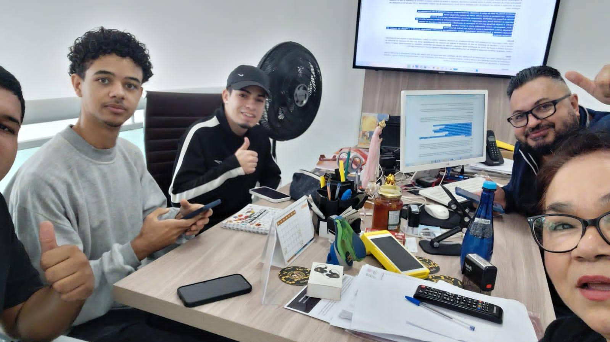
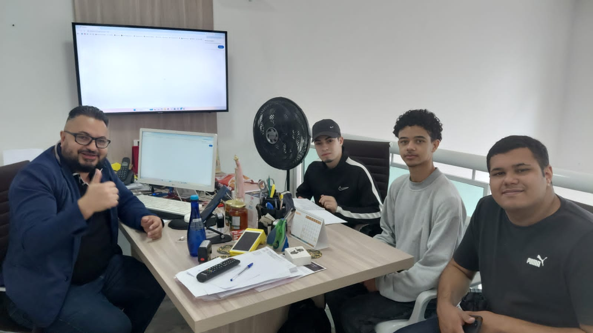
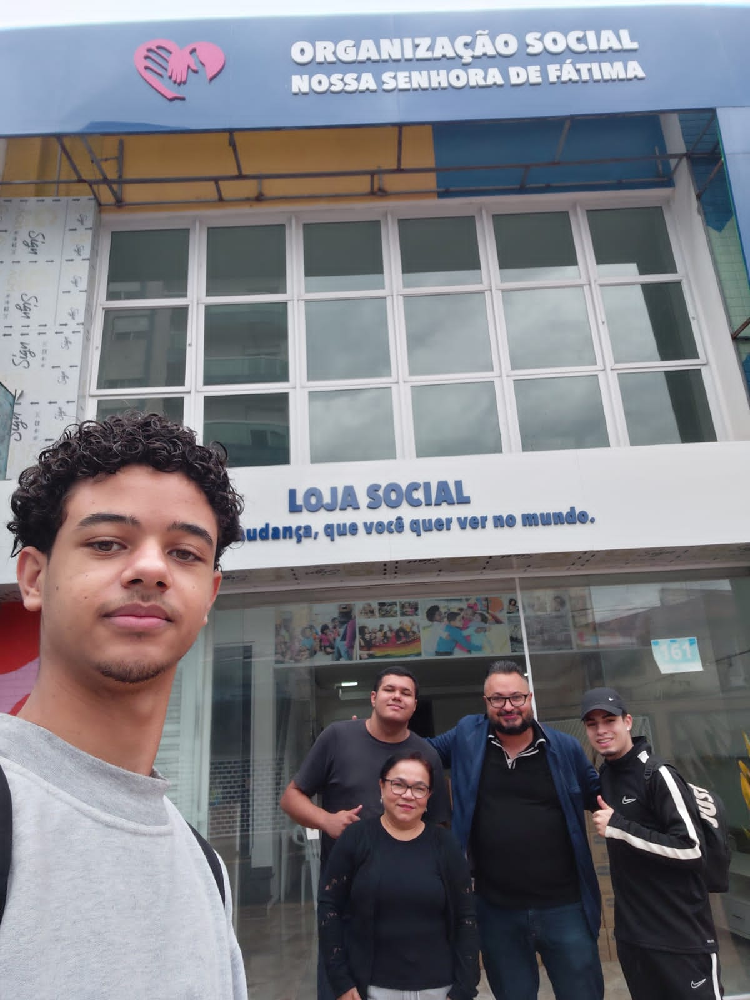
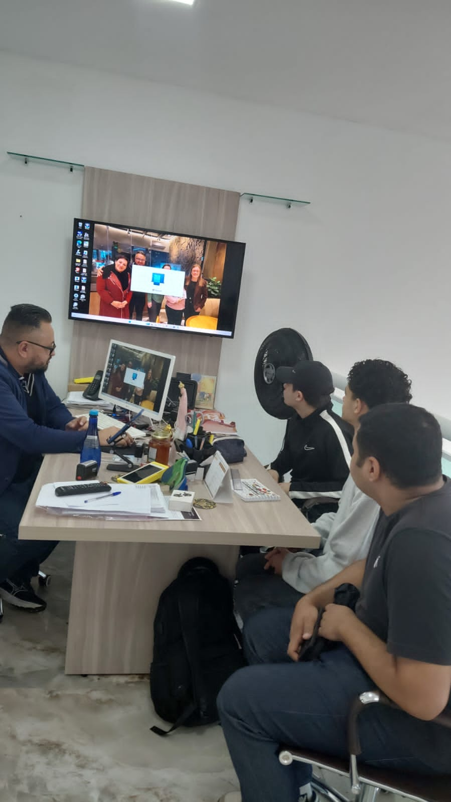
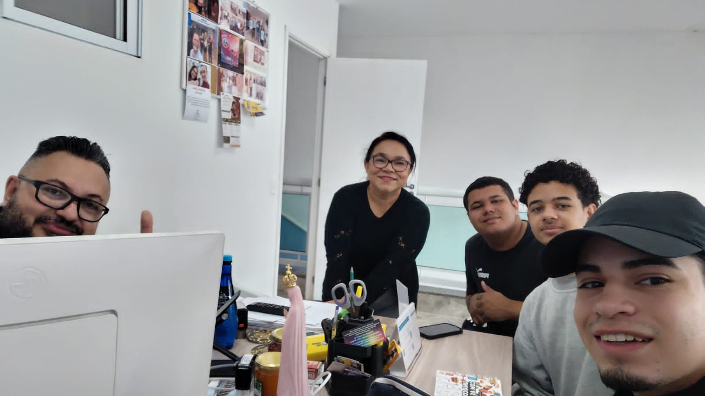

# Levantamento de campo

[← Voltar ao README](../../README.md)

| Item | Informação |
| :--- | :--- |
| Organização | Organização Social Nossa Senhora de Fátima |
| Data da visita | 12/09/2026, das 11h00 às 14h30 |
| Local | Sede da ONG, Mooca, São Paulo - SP |
| Pessoas ouvidas | A assistente social da equipe técnica e o presidente da ONG |
| Roteiro | Checklist preparado pelo grupo antes da visita (atividades, cadastro, doações, voluntários, ferramentas e problemas) |

> 🔒 **Privacidade (correção do professor):** a versão anterior deste levantamento trazia o nome completo e o telefone da assistente social. Esses dados foram retirados. A equipe técnica é identificada só pela função.

---

## 1. Conflito de interesse

Um integrante do grupo, **Washington de Souza Silva**, é presidente da ONG. Foi por meio dele que o grupo teve acesso à instituição. O professor apontou isso como possível conflito de interesse.

O que o grupo fez para reduzir o viés:

1. A entrevista técnica também foi feita com a **assistente social**, que não faz parte do grupo.
2. O modelo foi conferido contra a **ficha de cadastro em papel** usada pela ONG, e não só contra o relato do presidente.
3. **Nenhum dado real** de beneficiário, doador ou voluntário foi usado. Toda a massa de dados é fictícia ([`massa-de-dados.md`](../massa-de-dados.md)).
4. Os problemas da operação atual (controle em papel, busca lenta de histórico, dificuldade de restringir o acesso a dados sensíveis) estão descritos abertamente, sem esconder pontos fracos da instituição.

---

## 2. Como foi a visita

1. **Reconhecimento do espaço (cerca de 1 hora).** Recepção de porta aberta, sala de atendimento social, área da Loja Social e o local onde os mantimentos ficam guardados.
2. **Conversa sobre o funcionamento (cerca de 1h30).** Missão da ONG, acolhimento das famílias, doações de parceiros (Banco de Alimentos, Projeto Cidade Invisível) e o lote bimestral de 150 cestas básicas da Prefeitura.
3. **Entrevista técnica.** Aplicação do roteiro do grupo para levantar requisitos, regras de negócio e os campos da ficha de cadastro.

---

## 3. O que foi levantado

| Pergunta do roteiro | Resposta |
| :--- | :--- |
| Principais atividades | Acolhimento de porta aberta, triagem socioeconômica, entrega de cestas básicas, encaminhamento para a rede externa (saúde, habitação, jurídico), acompanhamento pelo PIA e passeios e atividades nos fins de semana |
| Perfil atendido | Famílias em vulnerabilidade social da região da Mooca, cerca de 250 famílias ativas |
| Como o cadastro é feito | Ficha impressa preenchida na entrevista com a assistente social: identificação, família, contatos, renda e trabalho |
| Voluntários | O presidente e cerca de 5 voluntários fixos, na recepção e no apoio operacional |
| Doações | Doações esporádicas de parceiros e particulares, mais o lote de 150 cestas da Prefeitura a cada 2 meses |
| Controle dos alimentos | Conferência visual de validade e embalagem antes de distribuir; o controle é manual |
| Ferramentas atuais | Quase tudo em papel, guardado em armário |
| Dificuldades | Papel se desgasta; achar o histórico de uma família é lento; difícil controlar quem acessa dados sensíveis (LGPD) |
| O que o sistema deve resolver | Digitalizar cadastro, triagem, histórico, doações, estoque, voluntários e eventos, com controle de acesso e prestação de contas |

Cada resposta virou um processo (seção 0 do README), um requisito (seção 2) ou uma regra de negócio (seção 3).

---

## 4. Fotos da visita

As fotos foram tiradas pelo grupo, com autorização da direção da ONG. Nenhuma ficha ou documento de beneficiário aparece de forma legível.

| | |
| :---: | :---: |
|  |  |
| **Foto 1.** Reunião na sala da equipe técnica | **Foto 2.** Conversa sobre o funcionamento da ONG |
|  |  |
| **Foto 3.** Fachada da ONG e da Loja Social | **Foto 4.** Aplicação do roteiro de entrevista |

**Foto 5.** Grupo com a equipe da ONG ao fim da visita.
