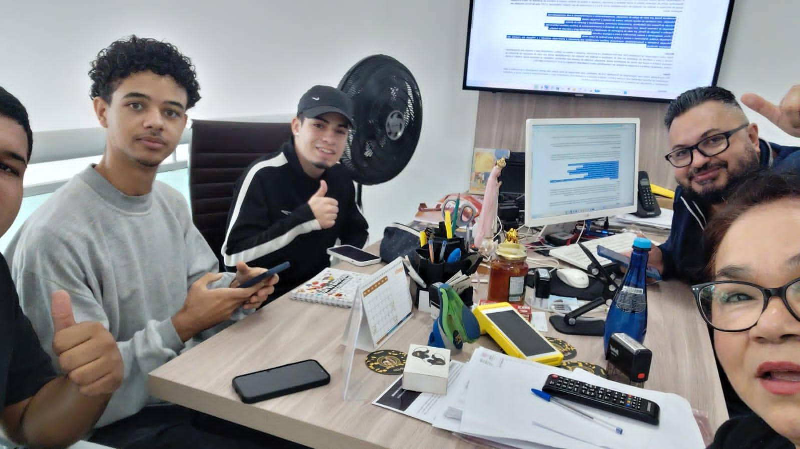
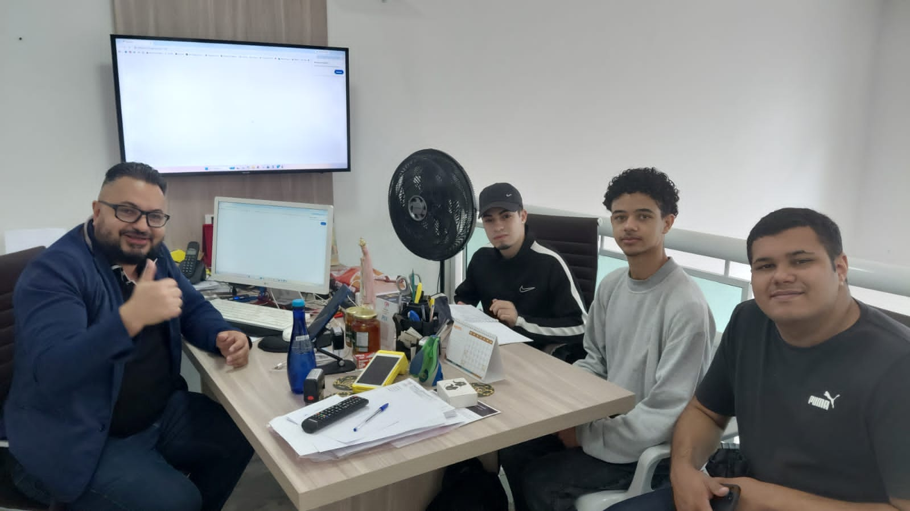
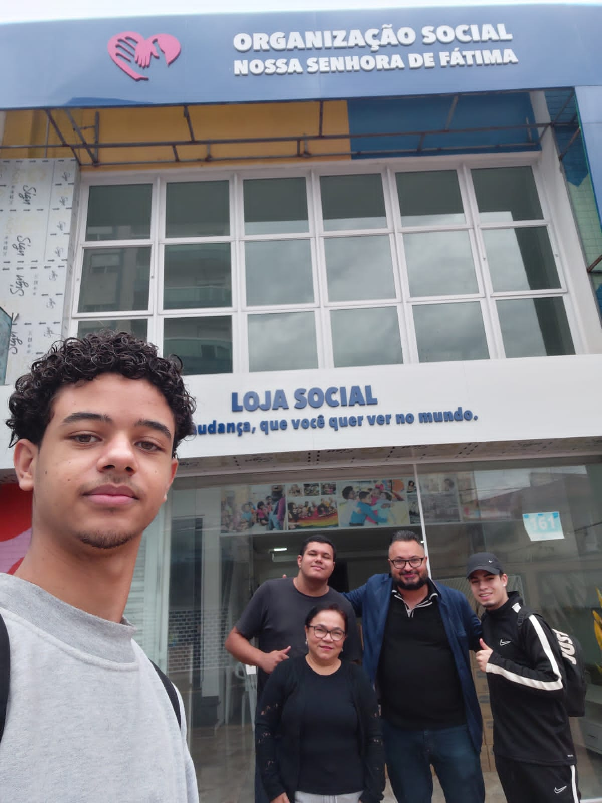
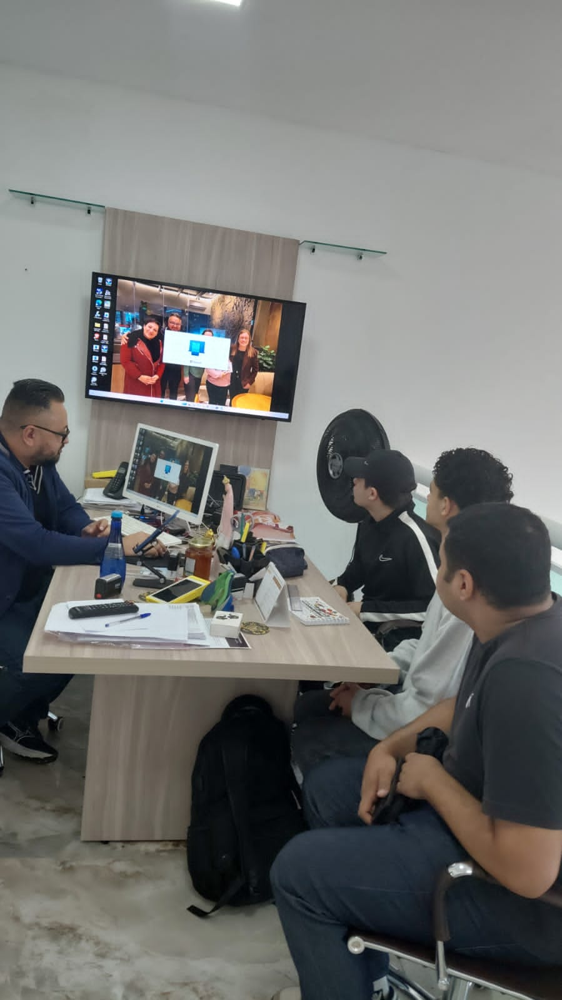
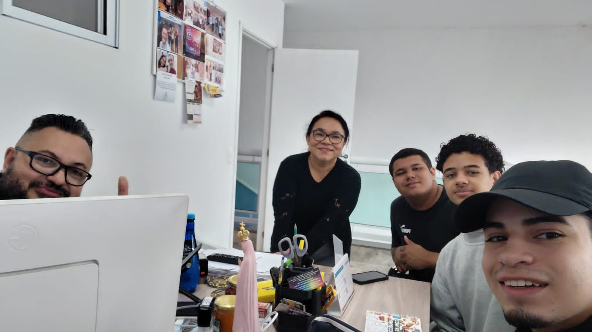

# Levantamento de campo — Organização Social Nossa Senhora de Fátima

[← Voltar ao README](../README.md#113-relato-da-entrevista-e-levantamento)

Texto escrito pelo grupo a partir da visita e da entrevista. Ele resume o que foi dito pela equipe da ONG e, separado, o que o grupo viu no local.

## 1. Dados da visita

| Item | Registro |
| :--- | :--- |
| Organização | Organização Social Nossa Senhora de Fátima (CNPJ 32.667.614/0001-18) |
| Data e horário | 12/09/2026, das 11h00 às 14h30 |
| Local | Sede da ONG, Rua Guaimbé, 161 — Mooca, São Paulo - SP |
| Quem atendeu o grupo | Maria Aparecida Fernandes Ferreira de Souza, assistente social responsável — (11) 96972-4382 |
| Entrevistados | A assistente social responsável e o presidente da ONG |
| Participantes | Integrantes do grupo, registrados nas fotos da seção 4 |
| Roteiro | Checklist preparado pelo grupo antes da visita: atividades, cadastro, doações, voluntários, ferramentas usadas e problemas |

**Vínculo declarado.** Washington de Souza Silva, integrante do grupo, é presidente da ONG, e foi por ele que o grupo teve acesso à instituição. Esse vínculo não substituiu a entrevista: a equipe técnica foi ouvida, e o modelo foi conferido contra a ficha de cadastro em papel, e não só contra o relato do presidente.

## 2. Como foi a visita

1. **Reconhecimento do espaço (cerca de 1 hora).** O grupo percorreu a recepção de porta aberta, a sala de atendimento social e o espaço onde os mantimentos e as doações ficam guardados até a entrega.
2. **Conversa sobre o funcionamento (cerca de 1h30).** Com a assistente social e o presidente: missão da ONG, acolhimento das famílias, doações de parceiros (Banco de Alimentos, Projeto Cidade Invisível) e o lote de 150 cestas básicas que a Prefeitura entrega a cada 2 meses.
3. **Entrevista técnica.** Aplicação do roteiro do grupo para levantar processos, requisitos, regras de negócio e os campos da ficha de cadastro.

## 3. O que foi levantado

### 3.1 O que foi dito

| Assunto | O que a equipe contou |
| :--- | :--- |
| Atividades | Acolhimento de porta aberta, triagem socioeconômica, entrega de cestas básicas, encaminhamento para a rede pública (saúde e saúde mental, habitação, assistência jurídica e outros), acompanhamento pelo PIA e passeios e atividades nos fins de semana |
| Porte | Cerca de 250 famílias atendidas; 1 assistente social; o presidente e cerca de 5 voluntários recorrentes |
| Cadastro | Ficha impressa preenchida na entrevista com a assistente social: identificação, documentos, família (até 5 moradores), contatos de emergência (até 3), trabalho e renda, benefícios sociais e a demanda |
| Doações | Doações esporádicas de parceiros e particulares, mais o lote de 150 cestas da Prefeitura a cada 2 meses |
| Alimentos | Validade e embalagem conferidas antes de distribuir; controle manual |
| Ferramentas | Quase tudo em papel, guardado em armário |
| Dificuldades | O papel se desgasta; achar o histórico de uma família é lento; é difícil controlar quem acessa dados sensíveis (LGPD) |
| O que esperam do sistema | Digitalizar cadastro, triagem, histórico e doações, com controle de acesso e relatórios para a prestação de contas |

### 3.2 O que o grupo viu (observação presencial)

| Observação | Comparação com o que foi dito |
| :--- | :--- |
| Papéis e documentos sobre a mesa da sala de atendimento | Confirma o registro em papel |
| Espaço de armazenamento de mantimentos e doações | Confirma que existe estoque, mesmo sem controle de saldo descrito |
| Recepção aberta para a rua | Confirma o atendimento sem hora marcada |
| Placa **"Loja Social"** na fachada | **Não foi tratada na entrevista.** Por isso a Loja Social ficou fora do modelo até uma nova visita |

### 3.3 Como o levantamento virou modelo

| Do levantamento | Para o modelo |
| :--- | :--- |
| Ficha de cadastro | `beneficiario`, `trabalho`, `composicao_familiar`, `referencia_familiar` |
| Triagem e demanda | `atendimento`, `encaminhamento_atendimento`, `pia` |
| Cestas, doações e armazenamento | `entrega_cesta`, `recebimento_doacao`, `item_recebimento`, `produto`, `saida_estoque`, `orgao_parceiro` |
| Voluntários e passeios | `voluntario`, `evento`, `participacao_evento`, `voluntario_evento` |
| Dificuldade de controlar o acesso | `log_acesso` e a matriz de papéis do [dicionário](../dicionario.md) |

Os processos, requisitos e regras resultantes estão nas seções 1.1.5 a 1.1.7 do [README](../README.md#115-processos-de-negócio).

## 4. Fotos da visita

Fotos tiradas pelo grupo, com autorização da direção da ONG. Nenhuma ficha ou documento de beneficiário aparece de forma legível.

| | |
| :---: | :---: |
|  |  |
| **Foto 1.** Reunião na sala da equipe técnica | **Foto 2.** Conversa sobre o funcionamento da ONG |
|  |  |
| **Foto 3.** Fachada da ONG e da Loja Social | **Foto 4.** Aplicação do roteiro de entrevista |

**Foto 5.** Grupo com a equipe da ONG ao fim da visita.
